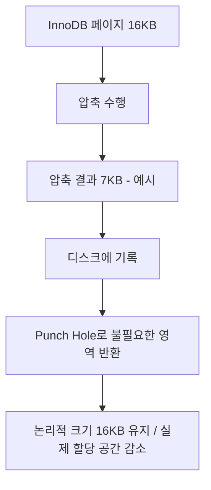
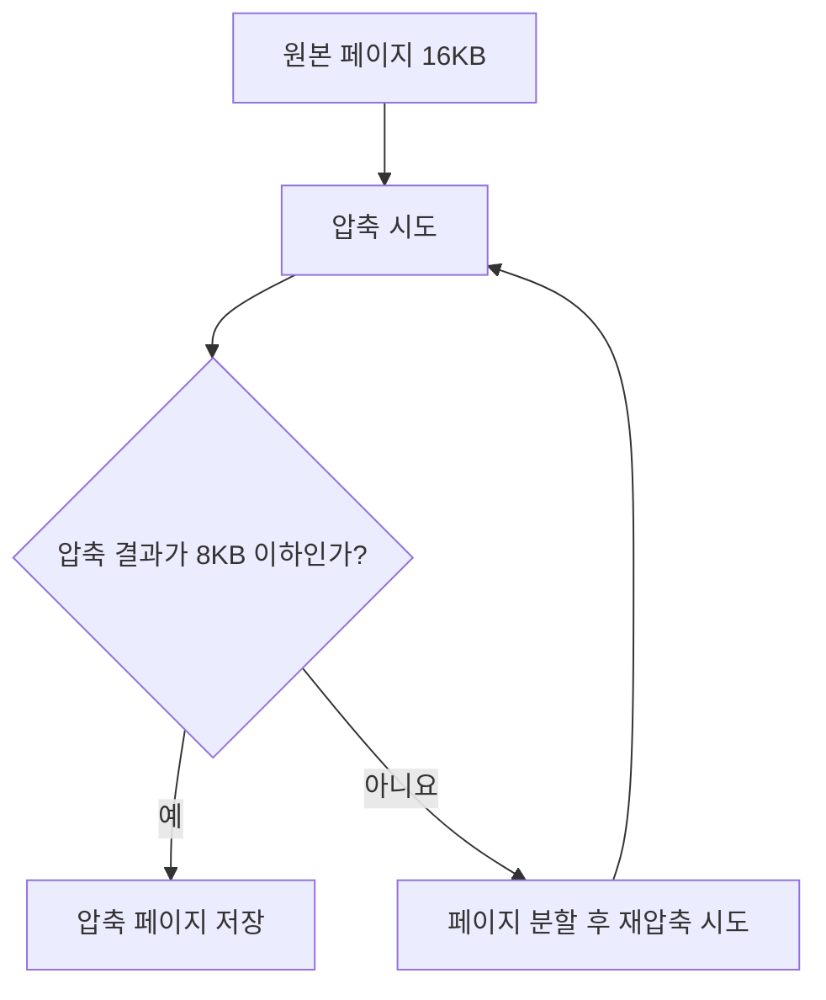

# 6장 데이터 압축

## 1. 데이터 압축이 필요한 이유

MySQL 데이터 파일이 커지면 버퍼 풀에 없는 페이지를 읽는 디스크 I/O, 백업·복구에 필요한 데이터량, 스토리지 비용이 늘어날 수 있다. InnoDB는 이를 완화하기 위해 **페이지 압축(Page Compression)**과 **테이블 압축(Table Compression)**을 제공한다. 두 방식은 압축된 데이터를 저장하고 관리하는 방법이 다르다.

### 사전 개념

- **페이지(Page)**: InnoDB가 데이터를 관리하는 기본 단위. 기본 크기는 **16KB**.
- **버퍼 풀(Buffer Pool)**: 데이터·인덱스 페이지를 RAM에 캐싱해 디스크 I/O를 줄이는 공간.
- **디스크 I/O**: 디스크에서 데이터를 읽거나 쓰는 작업. 일반적으로 메모리 접근보다 비용이 크다.

## 2. 페이지 압축 (Page Compression)

### 2.1 동작 원리

페이지 압축은 **Transparent Page Compression**이라고도 한다. InnoDB가 페이지를 디스크에 기록할 때 압축하고, 읽을 때 압축을 해제한다. 논리적 페이지 크기(기본 16KB)는 유지하면서 실제 디스크에 할당되는 공간을 줄인다.



### 2.2 Punch Hole이란?

**Punch Hole**은 파일의 특정 영역에 할당된 디스크 블록을 파일 시스템에 반환하는 기능이다.

1. 16KB 페이지를 압축한다.
2. 압축된 데이터를 디스크에 기록한다.
3. 남는 영역에 Punch Hole을 적용한다.
4. 파일의 논리적 크기를 유지하면서 실제 할당 공간을 절약한다.

예를 들어 16KB가 7KB로 압축되어도, **실제 절약량은 파일 시스템 블록 크기 등에 따라 달라진다.**

### 2.3 한계

- 운영체제·파일 시스템이 Punch Hole을 지원해야 한다.
- 일부 백업·복사 도구는 희소 파일(Sparse File)의 빈 영역을 실제 데이터로 복사해 공간 절약 효과를 잃게 할 수 있다.
- 압축 효과뿐 아니라 **백업·복구 호환성**도 검증해야 한다.

설정 예시:

```sql
CREATE TABLE t1 (c1 INT) COMPRESSION='zlib';

-- 기존 테이블의 압축 설정 변경 후 재구성
ALTER TABLE t1 COMPRESSION='zlib';
OPTIMIZE TABLE t1;
```

## 3. 테이블 압축 (Table Compression)

테이블 압축은 InnoDB가 압축 페이지를 직접 관리하는 방식이다. 파일 시스템의 Punch Hole에 의존하지 않지만, 압축·해제와 페이지 분할로 CPU 및 메모리 비용이 발생할 수 있다.

### 3.1 동작 원리

```sql
CREATE TABLE compressed_table (
    id BIGINT PRIMARY KEY
) ROW_FORMAT=COMPRESSED KEY_BLOCK_SIZE=8;
```

`KEY_BLOCK_SIZE=8`은 압축 페이지의 **목표 크기 8KB**를 뜻한다. 기본 16KB 페이지를 가정하면:



압축 결과가 목표 크기를 초과하면 페이지에 저장된 레코드를 분할하고 재압축을 시도할 수 있다. 이 과정이 잦으면 CPU 비용과 페이지 관리 부담이 증가한다.

### 3.2 KEY_BLOCK_SIZE 선택

| 설정 | 기대 효과 | 주의점 |
|---|---|---|
| 4KB | 공간 절약 가능성이 큼 | 압축 실패·페이지 분할 증가 가능 |
| 8KB | 목표 크기 충족 가능성이 상대적으로 높음 | 4KB보다 절약 공간이 작을 수 있음 |

**작게 설정할수록 무조건 좋은 것은 아니다.** 실제 데이터로 압축 실패율과 저장 공간을 비교해야 한다.

### 3.3 책의 실험 결과

`employees` 테이블을 대상으로 한 책의 예제 결과:

| 지표 | 압축 없음 | 4KB 압축 | 8KB 압축 |
|---|---:|---:|---:|
| 데이터 파일 크기 | 30MB | 20MB | 21MB |
| PRIMARY 인덱스 압축 실패율 | — | 약 27.67% | 약 18.52% |

- 4KB는 파일 크기를 더 줄였지만 압축 실패율도 높았다.
- 8KB는 공간 절약 효과가 조금 작지만 압축 실패율이 상대적으로 낮았다.
- **압축 실패율이 높아도 무조건 압축을 배제할 필요는 없다.** INSERT 이후 변경이 드문 데이터라면 초기 압축 비용을 감수할 수도 있다.

> 수치는 책의 예제 환경에서 나온 결과이며, 일반적인 압축률이나 성능 개선치를 의미하지 않는다.

## 4. 압축된 페이지와 버퍼 풀

테이블 압축에서는 압축된 페이지와 압축 해제된 페이지를 버퍼 풀에서 함께 관리할 수 있다.

| 리스트 | 역할 |
|---|---|
| **LRU** | 버퍼 풀의 페이지 관리. 압축 페이지와 일반 페이지가 포함될 수 있음 |
| **Unzip_LRU** | 압축 페이지의 **압축 해제된 버전**을 별도로 관리 |

- **CPU 부담이 클 때**: 자주 사용하는 압축 해제 버전을 유지하면 반복적인 압축 해제를 줄일 수 있다.
- **메모리 공간이 부족할 때**: 압축 해제 버전을 제거해 버퍼 풀 공간을 확보할 수 있다.

InnoDB는 사용 패턴에 따라 이를 적응적으로 조정한다. 따라서 압축은 디스크 사용량뿐 아니라 **버퍼 풀 효율과 CPU 사용량**에도 영향을 준다.

## 5. 페이지 압축 vs 테이블 압축

| 비교 항목 | 페이지 압축 | 테이블 압축 |
|---|---|---|
| 핵심 방식 | 압축 후 Punch Hole | 압축 페이지를 InnoDB가 직접 관리 |
| 파일 시스템 의존성 | 높음 | 상대적으로 낮음 |
| 페이지 관리 | 논리적 페이지 크기 유지 | 압축 페이지의 목표 크기 지정 |
| 버퍼 풀 | 일반적인 비압축 페이지 중심 | 압축·압축 해제 버전 관리 |
| 주요 고려 사항 | 파일 시스템·백업 호환성 | CPU·페이지 분할·버퍼 풀 |
| 대표 옵션 | `COMPRESSION` | `ROW_FORMAT=COMPRESSED`, `KEY_BLOCK_SIZE` |

## 6. 백엔드 개발자 관점에서의 트레이드오프

| 데이터·서비스 특성 | 고려 사항 |
|---|---|
| INSERT 후 거의 변경되지 않는 데이터 | 초기 압축 비용을 감수하고 공간 절약 가능 |
| UPDATE가 잦은 데이터 | 재압축·페이지 분할 비용 주의 |
| CPU 사용량이 높은 서비스 | 압축·해제 오버헤드 주의 |
| 디스크 용량·I/O가 병목인 서비스 | 압축 검토 가치가 있음 |
| 지연 시간에 민감한 서비스 | 주요 쿼리의 p95/p99 측정 필요 |

예를 들어 오래된 로그나 주문 이력처럼 쌓이기만 하고 수정이 드문 데이터는 압축을 검토할 수 있다. 반대로 상태 변경이 잦은 테이블에서는 압축 비용이 부담이 될 수 있다. **실제 워크로드로 판단해야 한다.**

### 적용 전후 확인할 지표

- 데이터 파일 크기 및 실제 디스크 할당량
- CPU 사용률
- 주요 쿼리 응답 시간(평균, p95, p99)
- 디스크 읽기·쓰기 I/O
- 압축 실패율 및 페이지 분할 관련 지표

테이블 압축의 인덱스별 압축 통계 조회 예시:

```sql
SELECT
    table_name,
    index_name,
    compress_ops,
    compress_ops_ok,
    ROUND(
        (compress_ops - compress_ops_ok) / NULLIF(compress_ops, 0) * 100,
        2
    ) AS compression_failure_pct
FROM information_schema.INNODB_CMP_PER_INDEX;
```

> 인덱스별 통계 수집에는 `innodb_cmp_per_index_enabled` 설정이 필요하며, 통계 수집 자체에도 오버헤드가 있으므로 진단·테스트 시 활용하는 편이 좋다.

## 7. 핵심 정리

1. **압축의 목적**은 디스크 공간과 일부 I/O 부담을 줄이는 것이다. 모든 쿼리가 빨라지는 것은 아니다.
2. **페이지 압축**은 Punch Hole 및 파일 시스템·백업 도구의 지원이 중요하다.
3. **테이블 압축**은 압축 실패, 페이지 분할, CPU 및 버퍼 풀 관리 비용이 중요하다.
4. **공간 절약과 성능은 트레이드오프**이므로, 데이터 변경 패턴과 실제 측정 결과를 바탕으로 도입해야 한다.

> 데이터 압축은 **디스크 공간을 줄이는 기술**이지, **무조건 쿼리 성능을 높이는 기술**이 아니다.
