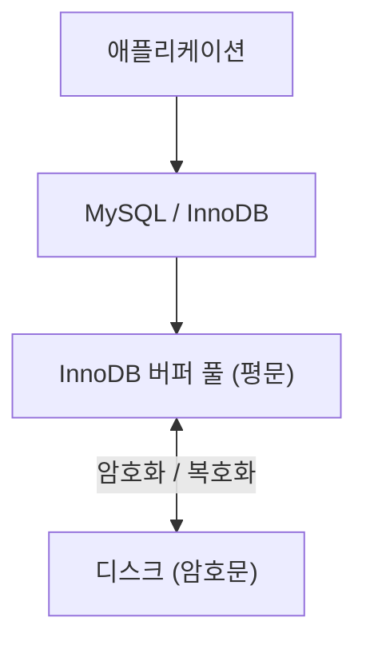
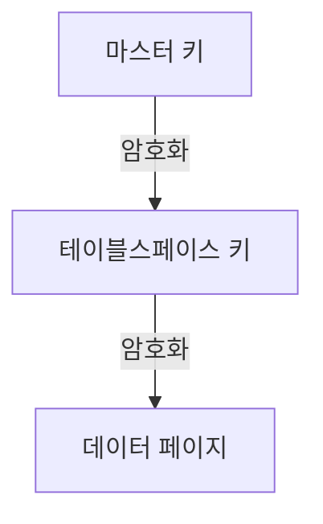

# 7장 데이터 암호화

MySQL의 데이터 암호화는 디스크에 저장된 데이터를 보호하기 위한 기능이다. MySQL 8.0에서는 테이블뿐 아니라 Undo/Redo 로그, 바이너리 로그까지 암호화를 지원한다.

## 1. 데이터 암호화 개요

MySQL은 **TDE(Transparent Data Encryption, 투명한 데이터 암호화)** 방식을 사용한다.

- **Data at Rest**: 디스크에 저장된 데이터를 암호화한다.
- **Transparent**: 애플리케이션이나 사용자가 암호화 여부를 의식할 필요가 없다.
- **암호화 위치**: InnoDB 스토리지 엔진의 I/O 레이어에서 암호화와 복호화를 수행한다.
- **버퍼 풀**: 디스크에서 읽어온 데이터는 복호화된 상태로 관리한다.

즉, 애플리케이션에서 별도의 암호화·복호화 로직을 구현하지 않아도 된다.



## 2. MySQL 서버의 데이터 암호화

### 2.1 2단계 키 관리

MySQL은 암호화 키를 두 단계로 관리한다.

| 구분 | 역할 |
|---|---|
| 마스터 키 (Master Key) | 테이블스페이스 키를 암호화하는 상위 키 |
| 테이블스페이스 키 (Tablespace Key) | 실제 데이터 파일을 암호화하는 키 |

**암호화 과정**

1. 테이블스페이스 키로 데이터 페이지를 암호화한다.
2. 마스터 키로 테이블스페이스 키를 암호화한다.
3. 암호화된 테이블스페이스 키를 데이터 파일 헤더에 저장한다.
4. 마스터 키는 Keyring 플러그인 또는 외부 키 관리 시스템에서 관리한다.



이렇게 키를 분리하면 마스터 키를 변경할 때 모든 데이터 페이지를 다시 암호화할 필요가 없다.

### 2.2 마스터 키 로테이션

보안상 마스터 키는 주기적으로 변경하는 것이 좋다.

```sql
ALTER INSTANCE ROTATE INNODB MASTER KEY;
```

- 기존 마스터 키로 테이블스페이스 키를 복호화한다.
- 새로운 마스터 키로 테이블스페이스 키를 다시 암호화한다.
- 실제 데이터 페이지는 다시 암호화하지 않는다.

따라서 전체 데이터를 재암호화하는 것보다 부담이 적다.

### 2.3 Keyring 플러그인

마스터 키를 관리하기 위한 구성 요소다.

- `keyring_file`: 로컬 파일에 키 저장
- `keyring_encrypted_file`: 암호화된 파일에 키 저장
- 외부 KMS: HashiCorp Vault 등 외부 키 관리 시스템 활용

**주의:** 마스터 키를 분실하면 암호화된 데이터를 복구할 수 없으므로 백업과 접근 권한 관리가 중요하다.

## 3. 암호화와 성능

TDE는 데이터가 디스크와 버퍼 풀 사이를 이동할 때 암호화·복호화를 수행한다.

| 구분 | 영향 |
|---|---|
| 버퍼 풀에 존재하는 데이터 조회 | 추가 복호화 작업 없음 |
| 디스크에서 데이터 읽기 | 복호화 비용 발생 |
| 변경된 데이터를 디스크에 기록 | 암호화 비용 발생 |
| 디스크 저장 공간 | 암호화만으로는 일반적으로 감소하지 않음 |

책의 테스트에서는 암호화된 테이블의 디스크 읽기·쓰기 시간이 증가했지만, 실제 성능 영향은 워크로드와 버퍼 풀 적중률에 따라 달라진다.

### 압축과 암호화를 함께 사용한다면?

**압축 → 암호화** 순서로 처리한다.

암호화된 데이터는 규칙성이 줄어 압축 효율이 떨어지기 때문이다.

## 4. 테이블 암호화

### 4.1 테이블 생성

```sql
CREATE TABLE tab_encrypted (
    id INT PRIMARY KEY,
    data VARCHAR(100)
) ENCRYPTION='Y';
```

테이블 암호화를 기본으로 적용하려면 다음 시스템 변수를 사용할 수 있다.

```sql
SET GLOBAL default_table_encryption = ON;
```

테이블 암호화 여부는 `information_schema.tables`의 `CREATE_OPTIONS`에서 확인할 수 있다.

### 4.2 애플리케이션 암호화와 비교

| 구분 | 애플리케이션 암호화 | MySQL TDE |
|---|---|---|
| 암호화 위치 | 애플리케이션 | InnoDB I/O 레이어 |
| DB 내부 데이터 | 암호문 | 평문으로 처리 |
| 인덱스 활용 | 제약 발생 가능 | 기존과 동일 |
| 범위 검색·정렬 | 제약 발생 가능 | 기존과 동일 |
| DB 접근 권한 탈취 | 평문 노출 방어 가능 | 평문 조회 가능 |
| 디스크 파일 탈취 | 데이터 보호 가능 | 데이터 보호 가능 |

애플리케이션 암호화는 특정 민감정보를 보호하는 데 유리하지만 검색과 인덱스 활용에 제약이 생길 수 있다.

반면 TDE는 쿼리나 인덱스 사용에 영향을 주지 않지만, **DB에 정상적으로 접근할 수 있는 사용자의 평문 조회까지 막아주지는 못한다.**

두 방식은 목적이 다르므로 함께 적용할 수도 있다.

### 4.3 테이블스페이스 이동

암호화된 테이블을 다른 MySQL 서버로 이동할 때는 키 관리에 주의해야 한다.

```sql
FLUSH TABLES source_table FOR EXPORT;
```

- 원본 서버와 대상 서버의 마스터 키가 다를 수 있다.
- 암호화된 테이블스페이스 이동 시 데이터 파일과 함께 생성된 `.cfp` 파일도 필요하다.
- 대상 서버에서 정상적으로 복호화할 수 있도록 키 정보를 전달해야 한다.

## 5. 로그 암호화

테이블을 암호화해도 로그 파일까지 자동으로 모두 암호화되는 것은 아니다.

### 5.1 Undo / Redo 로그 암호화

MySQL 8.0.16부터 관련 암호화 기능을 지원한다.

```sql
SET GLOBAL innodb_undo_log_encrypt = ON;
SET GLOBAL innodb_redo_log_encrypt = ON;
```

- 테이블 암호화와 별도로 설정해야 한다.
- 설정 이후 새롭게 기록되는 로그부터 암호화가 적용된다.
- 암호화를 비활성화해도 기존 암호화 로그가 즉시 평문으로 바뀌지는 않는다.

### 5.2 바이너리 로그 암호화

바이너리 로그는 복제와 데이터 복구에 사용되며, 데이터 변경 이력이 기록된다.

```sql
SET GLOBAL binlog_encryption = ON;
```

바이너리 로그 암호화에도 2단계 키 관리 방식을 사용한다.

- 파일 키: 개별 바이너리 로그 파일을 암호화
- 바이너리 로그 암호화 키: 파일 키를 암호화

암호화 키는 다음 명령으로 변경할 수 있다.

```sql
ALTER INSTANCE ROTATE BINLOG MASTER KEY;
```

암호화된 바이너리 로그 파일은 `mysqlbinlog`로 직접 읽을 수 없다. MySQL 서버를 통해 읽어야 한다.

```bash
mysqlbinlog --read-from-remote-server \
  -u root -p mysql-bin.000011
```

복제 시 네트워크 구간의 암호화는 별도 문제이므로 TLS 설정이 필요하다.

## 6. 운영 시 주의사항

### 키 관리와 백업

- 데이터 파일뿐 아니라 암호화 키도 안전하게 백업해야 한다.
- 키가 없으면 데이터 파일만으로 복구할 수 없다.
- 마스터 키 변경 시 기존 백업의 복구 가능 여부를 고려해야 한다.
- 키 관리 시스템의 장애나 접근 권한 문제도 서비스 복구에 영향을 줄 수 있다.

### 복제와 로그

- 복제 서버는 자체 마스터 키를 관리한다.
- 암호화된 데이터 파일을 복사하는 것과 MySQL 복제로 데이터를 전달하는 것은 다르다.
- 바이너리 로그의 디스크 암호화와 복제 네트워크의 TLS 암호화는 별도로 관리해야 한다.

## 7. 핵심 정리

| 핵심 개념 | 내용 |
|---|---|
| TDE | 디스크에 저장되는 데이터를 투명하게 암호화 |
| 암호화 위치 | InnoDB I/O 레이어 |
| 2단계 키 관리 | 마스터 키와 테이블스페이스 키 분리 |
| 마스터 키 로테이션 | 데이터 페이지 재암호화 없이 상위 키 변경 |
| 성능 영향 | 디스크 I/O 시 암호화·복호화 비용 발생 |
| 애플리케이션 암호화 | 특정 민감정보 보호에 활용 |
| 로그 암호화 | Undo/Redo/Binary 로그별 별도 설정 |
| 백업·복구 | 암호화 키 관리가 필수 |

## 8. 요약

- MySQL의 TDE는 **디스크에 저장된 데이터 보호**를 위한 기능이다.
- 암호화된 데이터도 버퍼 풀에서는 평문으로 처리되므로 일반적인 쿼리 실행 방식은 달라지지 않는다.
- 마스터 키와 테이블스페이스 키를 분리해 키 변경 비용을 줄인다.
- 테이블 암호화만으로 Undo/Redo/Binary 로그까지 모두 보호되는 것은 아니다.
- TDE는 DB 계정 탈취에 의한 평문 조회를 방지하지 못하므로 접근 제어와 애플리케이션 암호화 등을 함께 고려해야 한다.
- 운영에서는 암호화 알고리즘 자체보다 **키 관리, 백업·복구, 성능 영향**을 이해하는 것이 중요하다.
