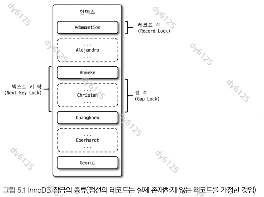
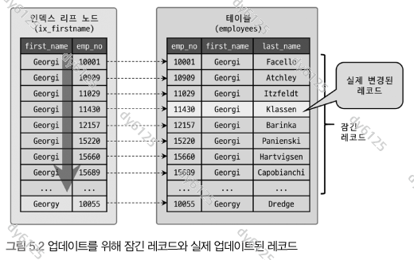
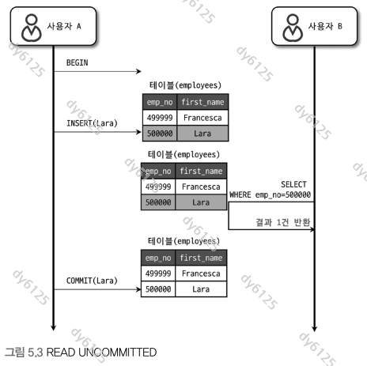
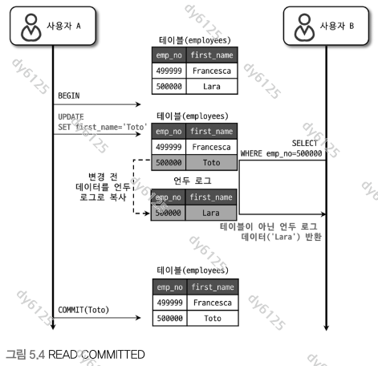
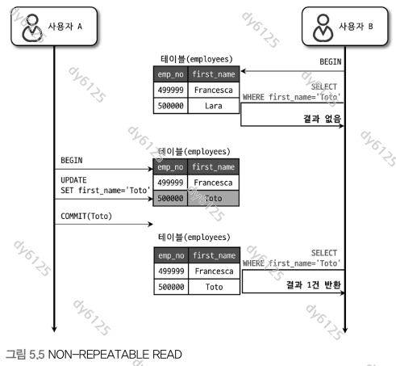
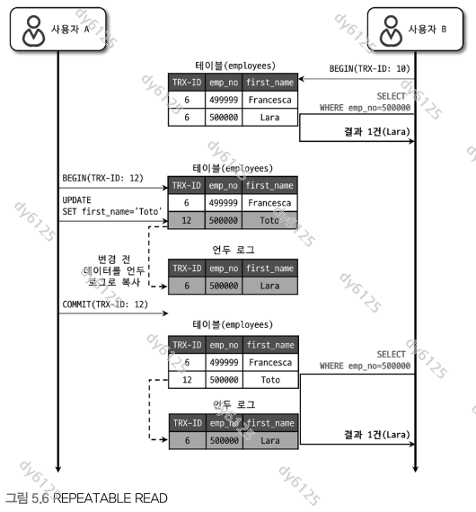
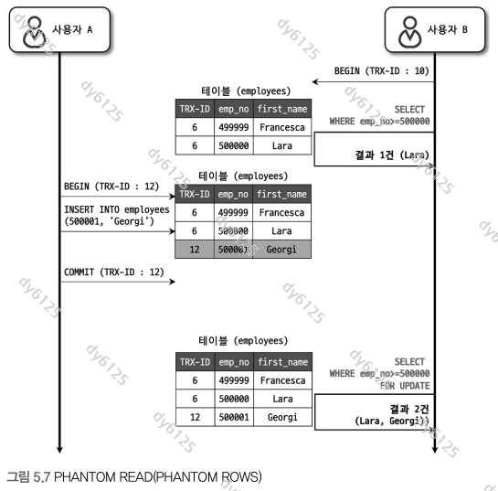

# Real MySQL 8.0 5장 트랜잭션과 잠금

아래 그림은 제공된 『Real MySQL 8.0』 원본에서 추출했다.

## 5.1 트랜잭션

이 장에서 구분할 세 가지 개념:

| 개념 | 다루는 문제 |
| --- | --- |
| 트랜잭션 | 함께 처리해야 하는 작업을 어디까지 묶어 커밋하거나 롤백할 것인가 |
| 잠금 | 같은 자원에 대한 동시 접근을 어떻게 조정할 것인가 |
| 격리 수준 | 다른 트랜잭션의 변경을 언제 볼 수 있고, 읽기와 쓰기를 어떻게 격리할 것인가 |

### 5.1.1 MySQL에서의 트랜잭션

트랜잭션을 사용하면 논리적인 작업 단위를 모두 반영하거나 취소할 수 있다. 여러 SQL을 묶을 때뿐 아니라 하나의 SQL로 여러 행을 변경할 때도 의미가 있다.

기존에 PK 값 `3`이 있는 테이블에 다음 문장을 실행한다고 가정한다.

```sql
INSERT INTO sample VALUES (1), (2), (3);
```

| 엔진 | 중복 키 오류 이후 상태 |
| --- | --- |
| MyISAM | 오류 전에 삽입된 `1`, `2`가 남을 수 있음 → 부분 업데이트 |
| InnoDB | 이 INSERT의 변경을 취소 → 기존 `3`만 유지 |

부분 업데이트가 발생하면 애플리케이션에서 성공한 작업을 찾아 되돌려야 한다. 되돌리는 작업도 실패할 수 있어 처리 흐름이 복잡해진다.

InnoDB에서는 함께 성공해야 하는 변경을 하나의 트랜잭션으로 묶는다.

```text
START TRANSACTION
  게시물 저장
  첨부 파일 메타데이터 저장
모두 성공하면 COMMIT
중간에 실패하면 애플리케이션에서 ROLLBACK
```

**보충:** 문장 실패와 트랜잭션 전체 실패는 구분한다. 중복 키 오류는 보통 해당 문장만 롤백한다. 앞서 성공한 SQL까지 자동으로 취소됐다고 생각하면 안 된다. 데드락처럼 전체 트랜잭션이 롤백되는 오류도 있다. [공식 문서: InnoDB 오류 처리](https://dev.mysql.com/doc/refman/8.0/en/innodb-error-handling.html)

### 5.1.2 주의사항

트랜잭션 범위는 **정합성을 위해 함께 처리해야 하는 DB 작업**을 기준으로 정한다.

```text
입력 검증·파일 처리
  → 커넥션 획득
  → 트랜잭션 시작
  → 게시물 + 첨부 파일 메타데이터 저장
  → 커밋·커넥션 반납
  → 외부 알림 전송
```

- 외부 API·메일 전송을 기다리는 동안 트랜잭션을 열어 두면 잠금과 커넥션 점유 시간이 길어진다.
- 읽기 트랜잭션을 오래 유지하면 이전 버전의 데이터가 계속 필요해 언두 정리가 지연될 수 있다.
- SQL 개수보다 **얼마나 오래 자원을 점유하는지**를 봐야 한다.

DB 커밋과 파일 저장·메일 발송은 하나의 DB 트랜잭션으로 함께 롤백되지 않는다. 트랜잭션 밖으로 옮긴 작업의 실패 처리와 재시도는 별도로 설계해야 한다.

## 5.2 MySQL 엔진의 잠금

서버 차원의 잠금과 InnoDB 내부의 레코드 잠금을 구분한다. InnoDB를 사용해도 메타데이터 락이나 명시적인 테이블 락의 영향을 받는다.

### 5.2.1 글로벌 락

글로벌 락은 서버 전체에 영향을 주며, 다른 세션의 일반적인 DDL·DML을 대기시킨다. 트랜잭션을 지원하지 않는 MyISAM·MEMORY 테이블까지 일관된 상태로 백업할 때 사용한다.

```sql
FLUSH TABLES WITH READ LOCK;
-- 필요한 백업 작업
UNLOCK TABLES;
```

잠금을 획득하는 과정에서도 테이블 플러시 때문에 오래 실행 중인 쿼리를 기다릴 수 있다. 범위가 서버 전체이므로 다른 데이터베이스의 쓰기까지 영향을 받는다.

#### 백업 락의 도입 배경

InnoDB에서는 트랜잭션과 온라인 백업 도구를 활용해 데이터 변경이 진행되는 동안에도 일관된 백업을 만들 수 있다. 따라서 백업 내내 글로벌 락으로 쓰기를 막으면 서비스 중단이나 복제 지연이 불필요하게 커질 수 있다.

하지만 백업 도중 테이블 삭제·이름 변경 등으로 파일 구조가 바뀌면 백업이 실패할 수 있다. 이를 막기 위해 MySQL 8.0에서는 **일반적인 DML은 허용하면서 백업을 깨뜨릴 수 있는 구조 변경을 제한하는 백업 락**을 제공한다.

```sql
LOCK INSTANCE FOR BACKUP;
-- 백업 도구로 백업 수행
UNLOCK INSTANCE;
```

- 일반적인 INSERT·UPDATE·DELETE는 허용한다.
- 파일 생성·삭제·이름 변경을 동반하는 작업, `TRUNCATE`·`OPTIMIZE`·`REPAIR TABLE`, 계정 관리 명령 등은 제한한다. 임시 테이블 관련 DDL 등에는 예외가 있다.
- 레플리카에서도 일반적인 데이터 변경은 계속 적용할 수 있다. 다만 충돌하는 DDL은 대기하므로 복제 지연이 완전히 없어지지는 않는다.

백업 락은 백업에 필요한 구조를 보호하는 기능이다. 데이터를 일관된 상태로 복구할 수 있도록 처리하는 일은 백업 도구가 담당한다. [공식 문서: LOCK INSTANCE FOR BACKUP](https://dev.mysql.com/doc/refman/8.0/en/lock-instance-for-backup.html)

### 5.2.2 테이블 락

```sql
LOCK TABLES sample READ;
-- 해당 테이블 읽기
UNLOCK TABLES;
```

- `LOCK TABLES ... READ / WRITE`로 테이블 단위 잠금을 명시할 수 있다.
- MyISAM·MEMORY의 변경 작업은 테이블 수준 잠금에 의존한다.
- InnoDB의 일반적인 DML은 레코드 기반 잠금을 사용한다.

InnoDB에도 테이블 수준의 **의도 잠금**(IS/IX)이 있다. 테이블 안에서 레코드 잠금을 사용할 것임을 표시한다. IX가 보인다고 테이블 전체의 모든 변경이 차단됐다는 뜻은 아니다.

### 5.2.3 네임드 락

테이블이나 행 대신 **문자열 이름**으로 동시 실행을 조정한다.

```sql
SELECT GET_LOCK('study.batch', 2);
-- 반환값이 1일 때만 보호하려는 작업 수행
SELECT RELEASE_LOCK('study.batch');
```

| 함수 | 의미 |
| --- | --- |
| `GET_LOCK(name, timeout)` | 획득 성공 `1`, 대기 시간 초과 `0`, 오류 `NULL` |
| `IS_FREE_LOCK(name)` | 다른 세션이 획득 가능한 이름인지 확인 |
| `RELEASE_LOCK(name)` | 현재 세션이 획득한 해당 잠금 해제 |
| `RELEASE_ALL_LOCKS()` | 현재 세션의 네임드 락을 모두 해제 |

**보충:** `2`는 획득을 기다리는 시간이다. 획득한 잠금이 2초 뒤 자동으로 풀리는 뜻이 아니다. 네임드 락은 세션에 속하므로 `COMMIT`·`ROLLBACK`으로 해제되지 않는다. 명시적으로 해제하거나 연결이 종료돼야 한다. [공식 문서: Locking Functions](https://dev.mysql.com/doc/refman/8.0/en/locking-functions.html)

같은 이름을 사용하는 세션끼리 협력하는 방식이며, 해당 MySQL 서버 범위에서 작동한다. 네임드 락을 사용하지 않는 코드의 DML까지 차단하지는 않는다. 커넥션 풀에서는 반납 전에 해제해야 한다.

### 5.2.4 메타데이터 락

메타데이터 락은 사용 중인 테이블의 이름·구조를 다른 세션이 변경할 때 생기는 충돌을 막는다.

- DDL뿐 아니라 테이블을 사용하는 SELECT·DML도 메타데이터 락을 획득한다.
- 트랜잭션이 테이블을 읽은 뒤 종료되지 않으면 `ALTER TABLE`이 기다릴 수 있다.
- 따라서 쿼리 실행이 끝난 유휴 세션도 DDL 대기의 원인일 수 있다.

이름 교체는 하나의 문장으로 묶을 수 있다.

```sql
RENAME TABLE current_table TO old_table,
             new_table TO current_table;
```

두 문장으로 나누면 중간에 `current_table`이라는 이름이 없는 순간이 생긴다. 하나의 `RENAME TABLE`로 묶으면 해당 이름들을 함께 잠그고 교체한다. 데이터 복사와 변경분 반영까지 자동으로 처리하지는 않는다.

## 5.3 InnoDB 스토리지 엔진 잠금

### 5.3.1 InnoDB 스토리지 엔진의 잠금

InnoDB의 레코드 잠금은 **인덱스 레코드**에 설정된다. 사용자 정의 인덱스가 없어도 내부 클러스터 인덱스를 사용한다. 잠금 수가 많아졌다는 이유로 테이블 락으로 승격하는 락 에스컬레이션은 없다.



#### 5.3.1.1 레코드 락

존재하는 인덱스 레코드 자체를 잠근다.

```sql
SELECT * FROM sample WHERE id = 10 FOR UPDATE;
```

`id`가 PK이고 `10`이 존재하면, 유일한 행을 찾는 동등 조건에서는 보통 해당 레코드만 잠근다.

유니크 인덱스를 사용해도 갭 락이 걸릴 수 있다. 범위 검색, 복합 유니크 인덱스 일부만 사용한 조건, 존재하지 않는 키 검색은 구분해야 한다.

#### 5.3.1.2 갭 락

인덱스 레코드 사이의 **간격에 새 레코드가 들어오는 것**을 막는다.

```text
인덱스 키: 10 ───────── 20
                ↑
          (10, 20) 갭
```

이 갭이 잠겨 있으면 다른 트랜잭션의 `15` 삽입이 대기할 수 있다. 기존 `10`, `20` 레코드를 잠그는 것과는 다르다.

#### 5.3.1.3 넥스트 키 락

**레코드 락 + 그 레코드 직전의 갭 락**이다. 위 예에서 `20`에 대한 넥스트 키 락은 `(10, 20]`을 보호한다.

REPEATABLE READ에서 범위를 잠그며 읽거나 변경할 때, 다른 트랜잭션이 범위 안에 새로운 행을 삽입하는 것을 제어한다. 실제 범위는 검색에 사용한 인덱스와 실행 계획에 따라 달라진다.

**보충:** `binlog_format=ROW`로 바꿨다고 갭 락이 사라지지는 않는다. READ COMMITTED에서는 일반 검색의 갭 락 사용이 줄어들지만 외래 키·중복 키 검사에는 사용된다. 격리 수준과 조회 조건을 함께 봐야 한다. [공식 문서: 격리 수준별 잠금](https://dev.mysql.com/doc/refman/8.0/en/innodb-transaction-isolation-levels.html)

#### 5.3.1.4 자동 증가 락

`AUTO_INCREMENT` 값을 할당할 때 동시성을 제어하는 방식은 `innodb_autoinc_lock_mode`에 따라 다르다.

| 값 | 방식 | 특징 |
| --- | --- | --- |
| `0` | Traditional | INSERT 계열 문장에서 테이블 수준 AUTO-INC 락 사용, 문장 종료까지 유지 |
| `1` | Consecutive | 건수를 아는 단순 INSERT는 가벼운 할당 방식, 건수를 모르는 대량 INSERT는 AUTO-INC 락 사용 |
| `2` | Interleaved | 테이블 수준 AUTO-INC 락 없이 할당, 동시 문장의 번호가 섞일 수 있음 |

MySQL 8.0 기본값은 `2`다. 번호 할당 순서는 커밋 순서가 아니며, 롤백·실패·미사용 예약 값 때문에 번호가 비어 있을 수 있다. `AUTO_INCREMENT`를 빈틈없는 업무 번호로 사용하면 안 된다.

### 5.3.2 인덱스와 잠금

**변경된 행 수와 잠긴 행 수는 다를 수 있다.**

책의 예제에서는 `first_name`만 인덱스에 있고, `Georgi`가 253명이며 그중 `Klassen`은 1명이다.

```sql
UPDATE employees
SET hire_date = CURRENT_DATE()
WHERE first_name = 'Georgi'
  AND last_name = 'Klassen';
```

이 인덱스를 사용하면 `Georgi`에 해당하는 범위를 탐색한 뒤 `last_name`을 확인한다. REPEATABLE READ에서는 실제 변경이 1건이어도 검색 과정에서 훨씬 넓은 범위에 잠금이 걸릴 수 있다.



```text
first_name 인덱스에서 후보 탐색
  → 후보 레코드에 잠금
  → last_name 조건 확인
  → 일치한 1건 변경
```

따라서 인덱스는 조회 속도뿐 아니라 잠금 범위와 동시성에도 영향을 준다. 다만 READ COMMITTED의 비일치 행 잠금 해제 등 차이가 있으므로, 모든 환경에서 잠금 수를 253개로 단정하지 않는다. [공식 문서: SQL별 잠금](https://dev.mysql.com/doc/refman/8.0/en/innodb-locks-set.html)

### 5.3.3 레코드 수준의 잠금 확인 및 해제

먼저 **기다리는 트랜잭션 → 막고 있는 트랜잭션** 관계를 찾는다.

```sql
SELECT r.trx_mysql_thread_id AS waiting_connection,
       r.trx_query AS waiting_query,
       b.trx_mysql_thread_id AS blocking_connection,
       b.trx_query AS blocking_query
FROM performance_schema.data_lock_waits AS w
JOIN information_schema.innodb_trx AS r
  ON r.trx_id = w.requesting_engine_transaction_id
JOIN information_schema.innodb_trx AS b
  ON b.trx_id = w.blocking_engine_transaction_id;
```

개별 잠금은 다음과 같이 확인한다.

```sql
SELECT engine_transaction_id, object_schema, object_name,
       index_name, lock_type, lock_mode, lock_status, lock_data
FROM performance_schema.data_locks;
```

- `X,REC_NOT_GAP`: 갭을 포함하지 않는 배타적 레코드 락.
- `IX`: 레코드에 배타적 잠금을 설정하려는 테이블 수준 의도 잠금.
- `blocking_query = NULL`: 현재 실행 중인 SQL이 없을 수 있다는 뜻. 미완료 트랜잭션의 잠금은 남아 있을 수 있다.

잠금 보유 세션의 `COMMIT`·`ROLLBACK`으로 트랜잭션을 끝내는 것이 기본이다. 연결을 강제로 종료하면 미커밋 작업이 롤백되므로, 대상 연결과 작업을 확인해야 한다. `KILL QUERY`는 실행 중인 문장을 중단할 뿐 트랜잭션 전체를 종료하는 명령이 아니다.

## 5.4 MySQL의 격리 수준

| 현상 | 의미 |
| --- | --- |
| Dirty Read | 다른 트랜잭션이 아직 커밋하지 않은 변경을 읽음 |
| Non-repeatable Read | 같은 행을 다시 읽었는데 다른 트랜잭션의 커밋으로 값이 달라짐 |
| Phantom Read | 같은 검색 조건으로 다시 읽었는데 조건에 맞는 행 집합이 달라짐 |

| 격리 수준 | 일반 SELECT에서의 핵심 동작 |
| --- | --- |
| READ UNCOMMITTED | 미커밋 변경을 읽을 수 있음 |
| READ COMMITTED | 일관된 읽기마다 새 스냅샷 사용 |
| REPEATABLE READ | 한 트랜잭션의 일관된 읽기는 첫 스냅샷 재사용 |
| SERIALIZABLE | 명시적 트랜잭션에서 일반 읽기에도 공유 잠금 적용 |

### 5.4.1 READ UNCOMMITTED

A가 값을 바꾼 뒤 커밋하기 전에 B가 변경 값을 읽을 수 있다. 이후 A가 롤백하면 B는 실제로 확정되지 않은 값을 바탕으로 작업한 셈이다.



더티 리드가 허용된다는 것이 핵심이다. **보충:** READ UNCOMMITTED도 SQL 표준의 네 가지 격리 수준 중 하나다. 책의 “표준에서 인정하지 않는다”는 설명과 구분한다. [공식 문서: Transaction Isolation Levels](https://dev.mysql.com/doc/refman/8.0/en/innodb-transaction-isolation-levels.html)

### 5.4.2 READ COMMITTED

일반 SELECT는 각 읽기 시점의 스냅샷을 사용한다. 다른 트랜잭션의 미커밋 값은 보지 않으며 필요하면 언두에서 이전 버전을 구성한다.



다른 트랜잭션이 중간에 커밋하면 같은 트랜잭션 안에서도 다음 SELECT 결과가 달라질 수 있다. 트랜잭션을 시작했다고 반복 조회 결과까지 고정되는 것은 아니다.



### 5.4.3 REPEATABLE READ

InnoDB의 기본 격리 수준이다. 일반적인 일관된 읽기는 같은 트랜잭션 안에서 스냅샷을 재사용한다.

**보충:** 보통 스냅샷은 `BEGIN` 실행 순간이 아니라 **첫 일관된 읽기**에서 만들어진다. REPEATABLE READ에서 시작 시점에 만들려면 `START TRANSACTION WITH CONSISTENT SNAPSHOT`을 사용한다. 자신의 변경은 같은 트랜잭션의 이후 조회에도 보인다. [공식 문서: Consistent Nonlocking Reads](https://dev.mysql.com/doc/refman/8.0/en/innodb-consistent-read.html)



아래는 READ COMMITTED와 REPEATABLE READ의 차이를 확인하기 위한 두 세션 예제다. 각 테스트는 별도 실습 스키마에서 초기값 `100`으로 시작한다.

```sql
CREATE TABLE isolation_sample (
    id INT PRIMARY KEY,
    amount INT NOT NULL
) ENGINE=InnoDB;
INSERT INTO isolation_sample VALUES (1, 100);
COMMIT;
```

| 순서 | 세션 A | 세션 B |
| --- | --- | --- |
| 1 | `SET SESSION TRANSACTION ISOLATION LEVEL REPEATABLE READ;` | |
| 2 | `START TRANSACTION;` | |
| 3 | `SELECT amount FROM isolation_sample WHERE id=1;` → `100` | |
| 4 | | `START TRANSACTION;` |
| 5 | | `UPDATE isolation_sample SET amount=200 WHERE id=1;` |
| 6 | | `COMMIT;` |
| 7 | 같은 일반 SELECT → REPEATABLE READ는 `100`, READ COMMITTED로 시작했다면 `200` | |
| 8 | `ROLLBACK;` | |

READ COMMITTED 비교 실험은 A의 격리 수준을 `READ COMMITTED`로 바꾸고, 이전 트랜잭션을 끝낸 뒤 초기값을 복원해 반복한다.

#### 일반 SELECT와 잠금 조회

`SELECT ... FOR UPDATE`·`FOR SHARE`는 과거 스냅샷을 그대로 읽는 일반 SELECT와 다르다. 현재 레코드를 읽고 잠그며, 충돌하는 미커밋 변경이 있으면 기다릴 수 있다.

위 예제의 7번 뒤, A가 끝나기 전에 다음을 실행하면 `200`을 볼 수 있다.

```sql
SELECT amount FROM isolation_sample WHERE id = 1 FOR UPDATE;
```

REPEATABLE READ의 팬텀 리드를 이해할 때도 읽기 방식을 나눠야 한다.

| 읽기 방식 | 다른 트랜잭션의 새 행에 대한 처리 |
| --- | --- |
| 일반 SELECT 반복 | 기존 스냅샷을 사용해 나중에 커밋된 행을 보지 않음 |
| 범위에 대한 잠금 조회 | 갭·넥스트 키 락으로 보호한 범위의 삽입을 막음 |
| 일반 SELECT 후 잠금 조회 | 서로 다른 시점의 상태를 보므로 결과가 달라질 수 있음 |

책의 그림 5.7은 첫 조회가 일반 SELECT인 사례다. 이를 “동일한 범위를 두 번 잠금 조회했는데 그 사이 삽입이 자유롭게 들어온다”로 이해하면 안 된다. [공식 문서: RR의 읽기 방식](https://dev.mysql.com/doc/refman/8.0/en/innodb-transaction-isolation-levels.html)



### 5.4.4 SERIALIZABLE

명시적 트랜잭션에서는 일반 SELECT도 공유 잠금을 획득하므로 읽기와 변경 사이에 추가로 대기가 발생할 수 있다. 공유 잠금끼리는 함께 읽을 수 있으므로 모든 접근을 한 세션만 할 수 있다는 뜻은 아니다.

**보충:** `autocommit=1`에서 단독으로 실행하는 SELECT는 그 자체로 읽기 전용 트랜잭션이므로 비잠금 일관된 읽기가 가능하다. “SERIALIZABLE이면 모든 SELECT가 무조건 잠근다”는 설명에는 실행 조건이 필요하다. [공식 문서: SERIALIZABLE](https://dev.mysql.com/doc/refman/8.0/en/innodb-transaction-isolation-levels.html)

## 다시 확인할 질문

- 한 행만 UPDATE했는데 여러 행의 변경이 기다리는 이유를 인덱스 탐색 범위로 설명할 수 있는가?
- 일반 SELECT가 끝난 세션도 DDL을 막을 수 있는 이유는 무엇인가?
- READ COMMITTED와 REPEATABLE READ의 스냅샷 생성 시점은 어떻게 다른가?
- REPEATABLE READ에서 일반 SELECT와 `FOR UPDATE`의 결과가 다를 수 있는 이유는 무엇인가?
- 커밋하면 해제되는 잠금과 세션이 명시적으로 해제해야 하는 잠금은 무엇인가?
