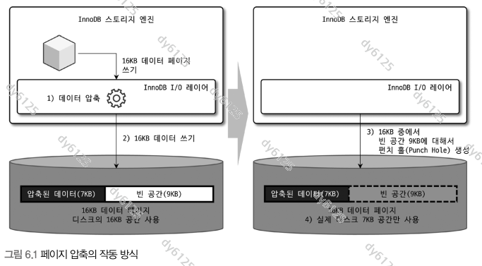
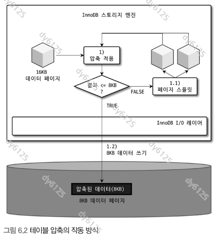

# Real MySQL 8.0 6장 데이터 압축

아래 그림은 제공된 『Real MySQL 8.0』 원본에서 추출했다.

데이터 압축은 저장 공간과 I/O를 줄일 수 있지만, 압축·해제에 CPU를 사용한다. 파일이 작아진 정도만으로 효과를 판단하기 어렵다.

| 구분 | 페이지 압축 | 테이블 압축 |
| --- | --- | --- |
| 설정 | `COMPRESSION='zlib'` 등 | `ROW_FORMAT=COMPRESSED`, `KEY_BLOCK_SIZE` |
| 중심 동작 | 디스크 I/O 시 압축·해제 | 목표 크기의 압축 페이지를 관리 |
| 버퍼 풀 | 압축 해제된 페이지 | 압축본과 압축 해제본이 함께 존재할 수 있음 |
| 공간 확보 | 파일 시스템의 펀치 홀 활용 | 압축 페이지 크기와 페이지 구성으로 절약 |
| 주요 비용·제약 | 파일 시스템 지원, 복사 시 희소성 유지 | 재압축·페이지 분할·메모리 사용 비용 |

## 6.1 페이지 압축

Transparent Page Compression은 디스크에 쓸 때 압축하고, 읽어 들일 때 해제한다. 버퍼 풀에서는 압축 해제된 페이지를 사용한다.

### 펀치 홀의 역할

페이지 주소를 계산하려면 논리적인 페이지 크기는 일정해야 한다. 페이지마다 압축 결과가 달라도 파일 안의 논리적 구간은 유지하고, 남는 구간에 할당된 디스크 공간을 해제한다.

```text
논리적 페이지 16KiB
  → 압축 결과 7KiB
  → 압축 데이터를 앞부분에 저장
  → 뒤쪽의 불필요한 블록을 펀치 홀로 반환
  → 파일의 논리적 크기와 실제 디스크 사용량이 달라짐
```

예를 들어 파일 시스템 블록이 4KiB라면 7KiB를 담는 데 2개 블록이 필요하다. 이 단순화된 예에서는 8KiB를 할당하고 나머지 8KiB를 반환할 수 있다. 실제 절감량은 압축 결과와 파일 시스템 블록 경계에 좌우된다.



책의 그림에서는 7KB를 저장하고 9KB를 반환한다고 가정한다. 파일 시스템 블록 단위가 달라 위의 4KiB 블록 예시와 실제 할당량에도 차이가 난다.

- 운영체제와 파일 시스템이 펀치 홀을 지원해야 한다.
- 파일의 논리적 길이만 보면 공간 절감이 드러나지 않을 수 있다.
- 백업·복사 도구가 희소 파일을 유지하지 않으면 빈 공간이 다시 물리적으로 할당될 수 있다.

책의 “복사하면 압축 효과가 사라질 수 있다”는 설명은 사용하는 도구와 옵션에 따라 확인할 사항이다. 모든 파일 복사가 항상 같은 결과를 내는 것은 아니다. [공식 문서: InnoDB Page Compression](https://dev.mysql.com/doc/refman/8.0/en/innodb-page-compression.html)

### 적용 예제

지원되는 환경의 file-per-table 테이블스페이스를 전제로 한다.

```sql
CREATE TABLE page_compressed (
    id BIGINT PRIMARY KEY,
    payload VARCHAR(1000)
) ENGINE=InnoDB COMPRESSION='zlib';

-- 기존 테이블에 적용하는 경우
ALTER TABLE page_compressed COMPRESSION='zlib';
OPTIMIZE TABLE page_compressed;
```

압축 속성을 바꿔도 기존 페이지 전체를 즉시 다시 기록하지는 않는다. 기존 데이터까지 적용하려면 테이블 재구성 같은 과정이 필요하다. `OPTIMIZE TABLE`을 실행하면 그 작업 비용도 든다.

## 6.2 테이블 압축

테이블 압축은 `zlib`로 데이터·인덱스 페이지를 압축한다. 페이지 압축과 달리 펀치 홀을 전제로 하지 않는다.

### 6.2.1 압축 테이블 생성

일반적인 file-per-table 구성에서는 `innodb_file_per_table=ON`인 환경에서 다음과 같이 테이블을 생성한다.

```sql
CREATE TABLE table_compressed (
    id BIGINT PRIMARY KEY,
    payload VARCHAR(1000)
) ENGINE=InnoDB
  ROW_FORMAT=COMPRESSED
  KEY_BLOCK_SIZE=8;
```

`KEY_BLOCK_SIZE=8`은 압축 페이지의 목표 크기가 8KiB라는 뜻이다. 원본 페이지가 16KiB일 때 모든 데이터가 정확히 절반으로 압축된다는 보장은 없다.

```text
원본 페이지 압축
  ├─ 목표 크기 이내 → 압축 페이지로 유지
  └─ 목표 크기 초과 → 페이지 재구성·분할 후 다시 압축
```

목표를 지나치게 작게 잡으면 분할과 재압축이 많아질 수 있다. 테이블을 생성한 뒤 데이터를 변경할 때도 압축 형식에 맞춰 페이지를 유지해야 한다.



**보충:** 책의 예제는 주로 4KiB·8KiB를 비교하지만, 공식 문서의 옵션 값은 `1`, `2`, `4`, `8`, `16`KiB다. 실제 사용 가능 조합은 `innodb_page_size`와 테이블스페이스 조건에 따른다. 32KiB·64KiB InnoDB 페이지 크기에서는 이 테이블 압축을 지원하지 않는다. 일반 테이블스페이스도 `FILE_BLOCK_SIZE` 조건을 맞추면 사용할 수 있다. [공식 문서: 압축 옵션과 제약](https://dev.mysql.com/doc/refman/8.0/en/innodb-compression-syntax-warnings.html)

### 6.2.2 KEY_BLOCK_SIZE 결정

목표 크기가 작다고 최종 파일도 그만큼 작아지지는 않는다. 작은 목표 크기에 맞추느라 페이지 수가 늘면 기대만큼 공간을 줄이지 못할 수 있다.

책의 실험 결과를 비교하면:

| 방식 | 파일 크기 | PRIMARY 압축 실패율 |
| --- | ---: | ---: |
| 압축 없음 | 약 30MB | 해당 없음 |
| 4KiB 목표 | 약 20MB | 약 27.67% |
| 8KiB 목표 | 약 21MB | 약 18.52% |

이 수치는 **책의 데이터와 실험 환경에서 나온 결과**다. 4KiB와 8KiB의 파일 크기 차이는 작지만 압축 실패율에는 차이가 있었다.

압축 실패는 SQL이나 데이터 저장의 실패가 아니라, **해당 압축 시도에서 목표 크기에 맞추지 못했다는 의미**다.

인덱스별 통계로 압축 비용이 어느 인덱스에서 발생하는지 확인할 수 있다.

```sql
-- 실습 환경에서 통계 수집 활성화. 전역 설정이므로 기존 값을 확인해 둔다.
SELECT @@GLOBAL.innodb_cmp_per_index_enabled;
SET GLOBAL innodb_cmp_per_index_enabled = ON;

-- 대표 데이터를 넣고 조회·변경 작업을 수행한 뒤 확인
SELECT database_name, table_name, index_name,
       compress_ops, compress_ops_ok,
       ROUND(100.0 * (compress_ops - compress_ops_ok)
             / NULLIF(compress_ops, 0), 2) AS failure_pct
FROM information_schema.innodb_cmp_per_index
WHERE database_name = DATABASE();
```

통계 수집에도 비용이 있다. 비교 후에는 기존 설정으로 복원한다. 누적 통계이므로 테스트 전후 차이를 비교하고, 4KiB·8KiB 후보에는 같은 데이터와 작업을 적용한다.

판단할 항목:

- 실제 디스크 절감량.
- 인덱스별 압축 실패율과 재압축 비용.
- 읽기·쓰기 처리량, 지연 시간, CPU 사용량.
- 초기 적재뿐 아니라 평소 UPDATE·DELETE 패턴에서의 변화.

책의 3~5% 미만 기준은 참고 기준이다. 한 번 저장한 뒤 거의 변경하지 않는 데이터와 빈번하게 수정되는 데이터를 같은 기준으로 판단하지 않는다.

### 6.2.3 압축된 페이지의 버퍼 풀 적재 및 사용

테이블 압축에서는 버퍼 풀에 압축본과 압축 해제본이 함께 존재할 수 있다.

```text
디스크의 압축 페이지
  → 버퍼 풀에 압축본 보관
  → 읽기·변경 시 압축 해제본 사용
  → 메모리가 필요하면 해제본을 제거하고 압축본만 유지 가능
```

| 목록 | 관리 대상 |
| --- | --- |
| LRU | 압축하지 않은 테이블의 페이지와 압축 테이블의 압축 페이지 |
| Unzip_LRU | 압축 페이지의 압축 해제본 |

해제본을 유지할지에 따라 메모리 사용량과 압축 해제 비용이 달라진다.

- 해제본을 오래 유지하면 메모리를 더 쓰지만 반복 해제를 줄일 수 있다.
- 해제본을 제거하면 공간을 확보하지만 다음 접근에서 다시 해제해야 한다.

압축본 8KiB와 해제본 16KiB를 함께 유지하면 한 논리 페이지에 약 24KiB가 필요할 수 있다. 반대로 압축본만 남긴 페이지는 공간을 절약한다. 따라서 모든 페이지를 항상 두 벌 보관한다거나 압축하면 항상 캐시 효율이 나빠진다고 단정하지 않는다.

InnoDB는 I/O와 압축·해제 비용을 고려해 해제본을 유지할지 조절한다. 책의 “CPU가 바쁘면 해제본 유지, I/O가 바쁘면 압축본 활용”은 이 선택을 이해하기 위한 설명이다. [공식 문서: 압축 페이지와 버퍼 풀](https://dev.mysql.com/doc/refman/8.0/en/innodb-compression-internals.html)

### 6.2.4 테이블 압축 관련 설정

| 설정 | 역할 | 확인할 비용 |
| --- | --- | --- |
| `innodb_cmp_per_index_enabled` | 인덱스별 압축 통계 수집 | 세부 통계 수집 비용 |
| `innodb_compression_level` | zlib 압축 레벨, 기본값 `6` | 압축률과 CPU 시간 |
| `innodb_compression_failure_threshold_pct` | 적응적 패딩 조정의 실패율 기준 | 압축 실패와 페이지 여유 공간 |
| `innodb_compression_pad_pct_max` | 패딩에 사용할 수 있는 최대 비율 | 한 페이지에 넣을 수 있는 데이터 감소 |
| `innodb_log_compressed_pages` | 재압축 페이지 이미지를 리두 로그에 기록 | 로그량과 복구 시 압축 재현 문제 |

패딩은 페이지에 데이터를 끝까지 채우지 않고 여유를 두는 방식이다. 목표 크기에 맞추기는 쉬워지지만 저장 밀도는 낮아질 수 있다.

`innodb_log_compressed_pages`는 기본값이 `ON`이다. 압축 결과를 리두에 남기면 zlib 버전 차이 등으로 복구 시 재압축 결과가 달라지는 문제를 피하는 데 도움이 되지만 로그량이 늘 수 있다.

**보충:** `INNODB_CMP`는 테이블별 통계가 아니라 **압축 페이지 크기별 집계**다. 테이블·인덱스를 구분하려면 `INNODB_CMP_PER_INDEX`를 사용한다. [공식 문서: INNODB_CMP](https://dev.mysql.com/doc/refman/8.0/en/information-schema-innodb-cmp-table.html)

## 다시 확인할 질문

- 페이지 압축에서 파일의 논리적 크기는 유지되는데 실제 디스크 사용량이 줄어드는 이유는 무엇인가?
- `KEY_BLOCK_SIZE=4`가 `8`보다 항상 공간을 더 절약하지는 않는 이유는 무엇인가?
- 압축 실패율이 높다는 것과 데이터 저장이 실패한다는 것은 어떻게 다른가?
- 버퍼 풀에 압축본과 해제본을 함께 두는 이유는 무엇인가?
- 압축 전후를 비교할 때 파일 크기 외에 어떤 지표가 필요한가?
