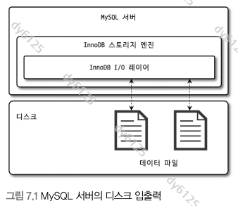
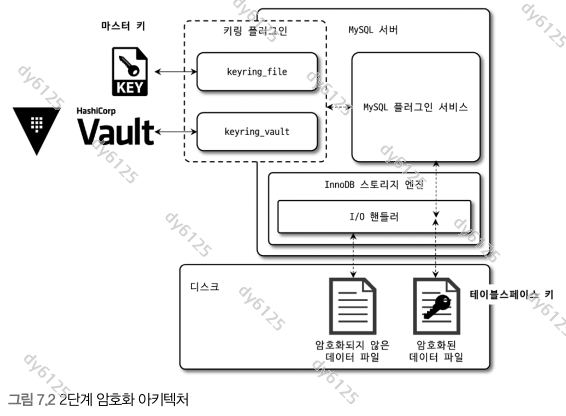
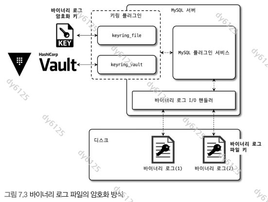

# Real MySQL 8.0 7장 데이터 암호화

아래 그림은 제공된 『Real MySQL 8.0』 원본에서 추출했다.

## 7.1 MySQL 서버의 데이터 암호화

MySQL의 TDE(Transparent Data Encryption)는 디스크에 저장되는 데이터를 암호화한다. 애플리케이션은 평소와 같은 SQL을 사용한다.



| 위치 | TDE와의 관계 |
| --- | --- |
| 디스크의 데이터 파일 | 암호화 적용 대상 |
| 버퍼 풀·쿼리 처리 | 복호화된 데이터를 사용 |
| 조회 권한이 있는 사용자의 SQL 결과 | 평문을 조회할 수 있음 |
| 클라이언트·복제 네트워크 | 전송 구간 암호화는 TLS 등으로 별도 처리 |

TDE를 이해할 때는 **어디에 저장된 데이터를 보호하는지**를 먼저 구분한다. 테이블 파일의 암호화가 로그·네트워크·SQL 조회 권한까지 모두 처리해 주지는 않는다.

### 7.1.1 2단계 키 관리

| 키 | 역할 | 보관 방식 |
| --- | --- | --- |
| 마스터 키 | 테이블스페이스 키를 암호화 | 키링을 통해 관리 |
| 테이블스페이스 키 | 실제 데이터 페이지를 암호화 | 마스터 키로 암호화해 테이블스페이스 헤더에 저장 |



```text
키링의 마스터 키
  → 테이블스페이스 키를 복호화
  → 테이블스페이스 키로 데이터 페이지를 복호화
```

InnoDB의 테이블스페이스 암호화는 AES-256을 사용한다. 책에서 설명하는 데이터 페이지 암호화 모드는 CBC, 테이블스페이스 키를 감싸는 방식은 ECB다. 이 설명을 모든 종류의 로그 암호화에 그대로 적용하지는 않는다.

마스터 키 교체 명령:

```sql
ALTER INSTANCE ROTATE INNODB MASTER KEY;
```

마스터 키를 교체할 때는 기존 마스터 키로 테이블스페이스 키를 풀고 새 마스터 키로 다시 암호화한다. 실제 데이터 페이지를 전부 복호화·재암호화할 필요가 없어 키 교체 비용을 줄일 수 있다.

여기서 테이블스페이스 키는 대칭키다. 책의 `private key` 표현을 공개키 암호 방식의 개인키로 혼동하지 않는다.

### 7.1.2 암호화와 성능

- 디스크에서 읽어 오는 페이지는 복호화 비용이 든다.
- 버퍼 풀에 적재된 페이지를 재사용할 때는 매번 다시 복호화하지 않는다.
- 더티 페이지를 디스크에 쓸 때는 암호화 비용이 든다.

백그라운드에서 쓰기 데이터를 암호화하더라도 CPU나 플러시 처리량이 부족하면 사용자 쿼리에 간접적으로 영향을 줄 수 있다. “백그라운드 작업이므로 성능 영향이 없다”로 이해하면 안 된다.

페이지 데이터를 암호화해도 압축되지는 않는다. 암호화 때문에 데이터 페이지의 크기나 버퍼 풀의 페이지 단위가 배수로 늘어나지도 않는다.

압축과 암호화를 함께 적용할 때의 저장 순서:

```text
원본 페이지 → 압축 → 암호화 → 디스크
```

암호화된 결과는 반복되는 패턴이 적어 압축 효율이 낮다. 먼저 압축한 뒤 암호화하는 이유다. 읽을 때는 복호화한 뒤 필요에 따라 압축을 해제한다.

책의 읽기·쓰기 지연 배수는 해당 실험 환경의 관측값이다. 전체 쿼리 성능의 고정된 감소율로 외우기보다, 버퍼 풀 적중률과 실제 디스크 I/O 비중을 함께 본다.

### 7.1.3 암호화와 복제

논리적인 데이터가 복제된다고 암호화 키나 데이터 파일의 바이트까지 같아지는 것은 아니다.

- 소스와 레플리카는 각자의 키링과 마스터 키를 관리한다.
- 같은 행 값도 서버마다 다른 키로 암호화돼 저장될 수 있다.
- InnoDB 마스터 키 교체 명령이 복제돼도 키 값 자체가 전달되는 것은 아니다.

암호화된 물리 백업을 복구하려면 데이터 파일뿐 아니라 해당 백업을 복호화할 키가 필요하다. 키를 데이터 파일과 별도로 보관하더라도 **백업 시점과 키의 대응 관계**를 관리해야 한다.

## 7.2 keyring_file 플러그인 설치

책에서 다루는 `keyring_file`은 키링 데이터를 로컬 파일에 보관한다. InnoDB가 암호화된 파일을 열 때 키링을 사용할 수 있어야 하므로 서버 시작 초기에 로드한다.

책에서 다루는 Linux 플러그인 방식의 설정 예:

```ini
[mysqld]
early-plugin-load=keyring_file.so
keyring_file_data=/secure/mysql/keyring
```

```sql
SHOW PLUGINS;
```

플러그인이 `ACTIVE`인지 확인하고, 서버별로 다른 키링 파일을 사용한다. 키링 파일을 잃으면 암호화된 파일을 정상적으로 열지 못할 수 있다.

`keyring_file`은 키 자체를 암호화해 보관하는 방식이 아니다. 데이터 파일과 키링 파일을 함께 얻으면 데이터를 복호화할 수 있으므로 키 파일의 접근 통제도 필요하다.

**버전 보충:** `keyring_file`은 MySQL **8.0.34부터 deprecated**다. 공식 문서는 `component_keyring_file` 사용을 안내한다. 따라서 “커뮤니티 에디션은 keyring_file 플러그인만 가능하다”는 책의 설명을 8.0 전체에 적용하면 안 된다. 컴포넌트는 설치 방식도 다르다. [공식 문서: keyring_file](https://dev.mysql.com/doc/refman/8.0/en/keyring-file-plugin.html)

이 절의 설정은 책에서 설명하는 구조를 이해하기 위한 예제다. 재시작하거나 키를 교체할 때도 키링 데이터가 필요하므로 서버 시작 후 키링 파일을 삭제하는 방식을 일반적인 구성 절차로 삼지 않는다.

## 7.3 테이블 암호화

### 7.3.1 테이블 생성

키링이 준비된 file-per-table 환경을 전제로 한다.

```sql
CREATE TABLE encrypted_sample (
    id INT PRIMARY KEY,
    data VARCHAR(100)
) ENGINE=InnoDB ENCRYPTION='Y';

INSERT INTO encrypted_sample VALUES (1, 'study');
SELECT * FROM encrypted_sample;

SELECT table_schema, table_name, create_options
FROM information_schema.tables
WHERE table_schema = DATABASE()
  AND table_name = 'encrypted_sample';
```

SQL에서는 `study`를 그대로 조회한다. 암호화 여부는 테이블의 저장 방식에 반영된다.

**보충:** `default_table_encryption`은 새 스키마·일반 테이블스페이스의 기본 암호화 설정을 결정한다. 테이블은 소속 스키마 등의 기본값을 상속한다. 전역 변수를 켰다고 기존 스키마의 기본값이나 기존 테이블이 모두 바뀌지는 않는다. [공식 문서: 암호화 기본값](https://dev.mysql.com/doc/refman/8.0/en/innodb-data-encryption.html)

```sql
CREATE DATABASE encrypted_study DEFAULT ENCRYPTION='Y';
-- 이 스키마에 새로 만드는 테이블은 기본 암호화 설정을 상속
```

기본값을 두면 암호화 적용 누락을 줄일 수 있다. 명시적 옵션으로 기본값을 바꾸는 것과 권한 정책은 별도로 구분한다.

### 7.3.2 응용 프로그램 암호화와의 비교

| 구분 | TDE | 응용 프로그램 암호화 |
| --- | --- | --- |
| DB가 처리하는 값 | 복호화된 값 | 애플리케이션이 만든 암호문 |
| SQL 조회 권한 보유자 | 평문을 볼 수 있음 | DB에 복호화 키가 없다면 암호문을 보게 됨 |
| 인덱스 범위 검색·정렬 | 기존 데이터 의미대로 사용 | 일반적인 암호문 순서는 평문 순서와 다름 |
| 주요 설계 지점 | 저장 파일과 키 관리 | 암호화 대상 컬럼·키 접근·검색 방법 |

응용 프로그램에서 출생 연도를 암호화해 저장했다면 암호문에 대한 `BETWEEN`이나 `ORDER BY`가 원래 연도 범위·순서를 의미하지 않는다.

동등 검색도 조건이 있다. 같은 평문이 같은 암호문을 만드는 방식이나 별도의 검색용 값이 있어야 단순 비교가 가능하다. 무작위 IV 등을 사용하는 일반적인 암호화에서는 같은 연도도 다른 암호문이 될 수 있다.

두 방식은 보호하는 위치가 다르므로 요구사항에 따라 함께 사용할 수 있다.

### 7.3.3 테이블스페이스 이동

서버마다 마스터 키가 다르므로 암호화된 `.ibd` 파일만 복사해서는 목적지에서 곧바로 읽을 수 없다.

```sql
FLUSH TABLES encrypted_sample FOR EXPORT;
-- 내보내기 세션을 유지한 상태에서 필요한 파일 복사
UNLOCK TABLES;
```

| 파일 | 역할 |
| --- | --- |
| `.ibd` | 테이블스페이스 데이터 |
| `.cfg` | 테이블 구조 확인에 사용하는 메타데이터 |
| `.cfp` | 전송 키와 그 키로 암호화한 테이블스페이스 키 |

**보충:** 암호화된 테이블스페이스를 내보낼 때 `.cfp`가 생성된다. 목적지에서는 여기에 담긴 키 정보를 이용해 가져온 데이터를 처리한다. `.cfp`까지 필요한 파일로 취급해야 한다. [공식 문서: 암호화 테이블스페이스 이동](https://dev.mysql.com/doc/refman/8.0/en/innodb-data-encryption.html)

내보내기 잠금은 테이블을 안정된 상태로 복사하기 위해 사용한다. 목적지에서는 테이블 정의를 준비하고 별도로 `IMPORT TABLESPACE` 절차를 거쳐야 한다.

## 7.4 언두 로그 및 리두 로그 암호화

테이블 암호화와 로그 암호화는 각각 설정한다. 메모리에서 처리한 데이터가 로그에 기록되기 때문에, 테이블 파일만 암호화하면 로그에 평문 정보가 남을 수 있다.

```sql
SET GLOBAL innodb_undo_log_encrypt = ON;
SET GLOBAL innodb_redo_log_encrypt = ON;

SHOW GLOBAL VARIABLES LIKE 'innodb_undo_log_encrypt';
SHOW GLOBAL VARIABLES LIKE 'innodb_redo_log_encrypt';
```

- 활성화 이후 기록하는 로그부터 암호화한다.
- 비활성화해도 이미 암호화된 로그가 즉시 모두 평문으로 바뀌는 것은 아니다.
- 기존 로그를 읽거나 복구하는 동안에는 해당 키가 계속 필요하다.
- 로그 데이터에는 로그용 키를 사용한다. 개별 테이블의 데이터 키와 같다고 생각하면 안 된다.

`SET GLOBAL`은 실행 중인 서버의 설정을 바꾼다. 재시작 후에도 설정이 유지되는지는 서버 설정 파일이나 영속 설정에서 별도로 확인한다.

특정 문자열이 로그에서 검색되지 않는다는 사실만으로 모든 로그가 암호화됐다고 증명할 수는 없다. 설정 적용 시점과 기존 로그의 상태를 함께 확인한다.

## 7.5 바이너리 로그 암호화

바이너리 로그와 릴레이 로그의 디스크 파일 암호화는 `binlog_encryption`으로 제어한다.

```sql
SET GLOBAL binlog_encryption = ON;
SHOW BINARY LOGS;
```

변경 시 새 로그 파일로 전환되며, 이전의 비암호화 로그를 일괄 암호화하지는 않는다. `SHOW BINARY LOGS`의 `Encrypted` 열에서 파일별 상태를 구분한다. 네트워크 전송 보호는 별도로 필요하다. [공식 문서: 바이너리·릴레이 로그 암호화](https://dev.mysql.com/doc/refman/8.0/en/replication-binlog-encryption.html)

### 7.5.1 바이너리 로그 암호화 키 관리

바이너리 로그와 릴레이 로그도 2단계로 키를 관리한다.



```text
키링의 바이너리 로그 암호화 키
  → 파일별 암호화 키를 보호
  → 각 파일 키로 바이너리·릴레이 로그 데이터 암호화
```

파일 키는 로그 파일 단위로 만들어진다. 이를 보호하는 바이너리 로그 암호화 키는 InnoDB 마스터 키와 구분한다.

### 7.5.2 바이너리 로그 암호화 키 변경

```sql
ALTER INSTANCE ROTATE BINLOG MASTER KEY;
```

책의 교체 흐름:

1. 새 바이너리 로그 암호화 키를 발급해 키링에 보관한다.
2. 바이너리·릴레이 로그를 새 파일로 전환한다.
3. 새 파일은 새 키 체계로 기록한다.
4. 서버가 관리하는 기존 암호화 로그의 파일 키도 새 암호화 키로 다시 보호한다.
5. 교체가 완료되면 불필요한 이전 키를 정리한다.

로그 내용을 전부 다시 암호화하는 것과 파일 키를 다시 암호화하는 것은 구분해야 한다. 외부에 복사해 둔 백업 파일까지 자동으로 바뀌지는 않는다.

| 교체 대상 | 명령 |
| --- | --- |
| InnoDB 데이터·언두·리두 관련 마스터 키 | `ALTER INSTANCE ROTATE INNODB MASTER KEY` |
| 바이너리·릴레이 로그 암호화 키 | `ALTER INSTANCE ROTATE BINLOG MASTER KEY` |

### 7.5.3 mysqlbinlog 도구 활용

`mysqlbinlog`는 암호화된 로컬 로그 파일을 직접 읽어 복호화하지 못한다. 로그와 키에 접근할 수 있는 MySQL 서버에 연결해 내용을 가져온다.

```bash
mysqlbinlog --read-from-remote-server \
  --host=db.example.com --user=log_reader --password \
  --ssl-mode=VERIFY_IDENTITY --ssl-ca=/path/to/ca.pem \
  --base64-output=DECODE-ROWS -vv mysql-bin.000123
```

서버 주소·계정·CA 경로·로그 파일명은 실습 환경 값으로 바꾼다. 계정에는 로그를 읽을 권한이 필요하다. 이 명령은 **행 이벤트를 사람이 확인하기 위한 출력**이며, `DECODE-ROWS` 결과를 그대로 복구용 SQL로 사용하지 않는다.

**보충:** 암호화 로그의 복사가 무의미한 것은 아니다. 백업한 암호화 로그를 사용하려면 대응하는 키링과 서버를 통한 복호화 경로도 준비해야 한다. 서버에서 전달받은 출력은 원본 로그 파일의 암호화가 그대로 유지되는 결과물이 아니다. [공식 문서: 암호화 바이너리 로그 사용](https://dev.mysql.com/doc/refman/8.0/en/replication-binlog-encryption.html)

## 다시 확인할 질문

- TDE를 적용해도 SELECT 결과가 평문인 이유는 무엇인가?
- 마스터 키를 교체할 때 모든 데이터 페이지를 다시 암호화하지 않아도 되는 이유는 무엇인가?
- 소스와 레플리카의 행 값이 같아도 암호화된 파일은 다를 수 있는가?
- 테이블 암호화를 켠 뒤에도 별도로 설정해야 하는 로그는 무엇인가?
- 암호화를 껐는데도 예전 키가 필요할 수 있는 이유는 무엇인가?
- 암호화된 백업을 복구하려면 데이터 파일 외에 무엇을 준비해야 하는가?
