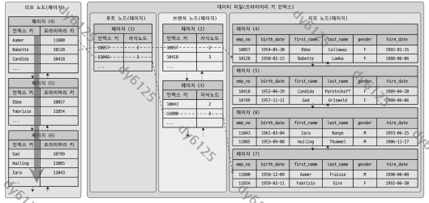
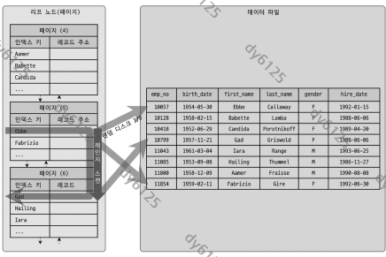
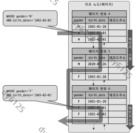
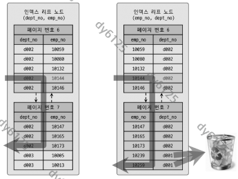
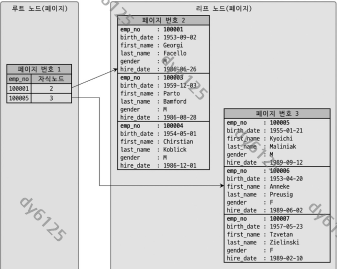

# Real MySQL 8.0 8장 인덱스

## 8.2 인덱스란?

- 컬럼 값과 레코드 주소를 짝지어 컬럼 값 순서로 정렬해 둔 자료 구조
- 자료 구조로 비유하면 인덱스는 SortedList, 데이터 파일은 ArrayList. 넣을 때 정렬 비용을 내고 찾을 때 빠름
- INSERT·UPDATE·DELETE 성능을 내주고 SELECT 속도를 얻는 거래. WHERE 절에 나오는 컬럼마다 인덱스를 만들면 쓰기만 느려짐

| 기준 | 구분 | 비고 |
| --- | --- | --- |
| 역할 | PK, 보조 인덱스 | 유니크 인덱스는 PK를 대신할 수 있어 대체 키라고도 함 |
| 저장 알고리즘 | B-Tree, Hash | Hash는 해시값으로 저장해 범위·전방 일치 검색 불가 |
| 중복 허용 | 유니크, 비유니크 | 유니크는 1건만 찾으면 끝난다는 사실을 옵티마이저에게 알려줌 |
| 기능 | 전문 검색, 공간 검색 | 8.5절, 8.4절 |

## 8.3 B-Tree 인덱스

- B는 Binary가 아니라 Balanced
- 컬럼 값을 변형하지 않고 정렬 상태로 보관. 전문 검색 같은 특수 요건이 아니면 거의 모든 인덱스가 B-Tree

### 8.3.1 구조 및 특성



- 루트와 브랜치 노드는 자식 노드 주소를, 리프 노드는 레코드를 찾아갈 주소를 보관
- 인덱스 키는 정렬돼 있지만 데이터 파일의 레코드는 임의 순서. 삭제로 생긴 빈 공간을 다음 INSERT가 재활용하기 때문
- InnoDB는 레코드 자체를 PK 순서로 저장하므로 예외

| 엔진 | 보조 인덱스 리프 노드의 값 | 레코드를 찾는 경로 |
| --- | --- | --- |
| MyISAM | 물리적 주소(INSERT 순번 또는 파일 오프셋) | 데이터 파일로 바로 이동 |
| InnoDB | PK 값(논리적 주소) | PK 인덱스를 한 번 더 탐색 |

- InnoDB는 보조 인덱스를 거칠 때마다 PK B-Tree를 한 번 더 탐색. 느려 보이지만 PK가 바뀌어도 보조 인덱스를 고치지 않아도 된다는 이점과 맞바꾼 것

### 8.3.2 B-Tree 인덱스 키 추가 및 삭제

| 작업 | 처리 방식 | 비용 |
| --- | --- | --- |
| 추가 | 위치를 찾아 리프에 저장. 리프가 가득 차면 분리되고 변경 범위가 브랜치 노드까지 넓어짐 | 레코드 추가를 1로 보면 인덱스 하나당 약 1.5배. 인덱스 3개면 5.5배 |
| 삭제 | 키에 삭제 마크만 표시 | 마킹에도 디스크 쓰기가 필요 |
| 변경 | 키 값이 위치를 정하므로 삭제 후 추가 | 위 두 작업의 합 |
| 검색 | 루트에서 리프까지 내려가는 트리 탐색. UPDATE, DELETE도 대상을 찾을 때 사용 | 100% 일치, 앞부분 일치, 부등호 비교에 사용. 뒷부분 일치나 키 값을 변형한 뒤의 비교에는 불가 |

- 비용의 대부분은 인덱스 페이지를 디스크에서 읽고 쓰는 시간
- InnoDB는 체인지 버퍼로 보조 인덱스의 추가·삭제를 지연. PK와 유니크 인덱스는 중복 검사 때문에 지연 불가
- 함수나 연산을 거친 결과로 정렬·검색하는 작업은 B-Tree의 장점을 쓰지 못함. 인덱스에는 원래 값만 정렬돼 있기 때문
- InnoDB는 레코드 잠금, 넥스트 키 락, 갭 락을 인덱스를 통해 걺. UPDATE·DELETE에 맞는 인덱스가 없으면 훑고 지나간 레코드까지 잠그고, 심하면 테이블의 모든 레코드가 잠김. 인덱스 설계가 잠금 범위까지 좌우하는 이유

### 8.3.3 B-Tree 인덱스 사용에 영향을 미치는 요소

#### 8.3.3.1 인덱스 키 값의 크기

- InnoDB 페이지는 기본 16KB. 자식 노드 주소를 12바이트로 잡으면 페이지 하나에 담기는 키 수가 정해짐

| 인덱스 키 크기 | 페이지당 키 수 | 깊이 3에서 최대 키 수 |
| --- | --- | --- |
| 16바이트 | 16×1024 / (16+12) = 585개 | 약 2억 개 |
| 32바이트 | 16×1024 / (32+12) = 372개 | 약 5천만 개 |

- 키가 크면 같은 건수를 읽을 때 페이지를 더 읽고, 버퍼 풀에 캐시되는 레코드 수도 줄어듦

#### 8.3.3.2 B-Tree 깊이

- 깊이 = 값 하나를 찾을 때 디스크를 랜덤하게 읽는 횟수
- 같은 건수라도 키가 크면 깊이가 깊어짐. 실제로 5를 넘는 일은 드묾

#### 8.3.3.3 선택도(기수성)

- 카디널리티 = 인덱스 키 가운데 유니크한 값의 수
- 레코드 1만 건인 tb_city에 country 컬럼만 인덱스가 있고 `WHERE country='KOREA' AND city='SEOUL'`의 결과가 1건인 경우

| country 유니크 값 | 키 하나당 예상 건수 | 결과 1건을 위해 버린 건수 |
| --- | --- | --- |
| 10개 | 1,000건 | 999건 |
| 1,000개 | 10건 | 9건 |

- MySQL은 인덱스된 컬럼의 통계만 관리하므로 city의 카디널리티는 작업량에 영향 없음

#### 8.3.3.4 읽어야 하는 레코드의 건수

- 옵티마이저는 인덱스를 거쳐 레코드 1건을 읽는 비용을 테이블 직접 읽기의 4~5배로 봄
- 읽을 레코드가 전체의 20~25%를 넘으면 테이블을 전부 읽고 필터링하는 쪽이 유리. 이때 인덱스 힌트를 줘도 옵티마이저는 보통 무시

**참고:** 인덱스로 읽으면 레코드마다 데이터 페이지를 랜덤 I/O로 가져오고, 풀 테이블 스캔은 페이지를 순차 I/O로 읽어 한 번에 수십~수백 건을 얻는다.

### 8.3.4 B-Tree 인덱스를 통한 데이터 읽기

#### 8.3.4.1 인덱스 레인지 스캔



- 범위가 정해진 검색의 기본 방식
- 처리 순서
  1. 루트에서 리프까지 내려가 시작 위치를 찾음(index seek)
  2. 리프를 순서대로 읽고, 리프가 끝나면 링크로 다음 리프로 넘어감(index scan)
  3. 읽은 키의 주소로 데이터 파일에서 레코드를 가져옴
- 3단계는 레코드 1건마다 랜덤 I/O가 생겨 비용이 큼. 인덱스에 있는 컬럼만 쓰는 쿼리는 이 단계를 건너뜀(커버링 인덱스)
- 탐색·스캔 횟수는 `SHOW STATUS LIKE 'Handler_%'`의 Handler_read_key, Handler_read_next, Handler_read_prev로 확인

#### 8.3.4.2 인덱스 풀 스캔

- 리프 노드를 처음부터 끝까지 읽는 방식. (A, B, C) 인덱스에서 B나 C만으로 검색할 때가 대표적
- 인덱스가 테이블보다 작아 테이블 풀 스캔보다는 낫지만, 책에서 "인덱스를 효율적으로 사용하지 못한다"고 하는 경우가 이것

#### 8.3.4.3 루스 인덱스 스캔

- 필요 없는 키를 건너뛰며 읽는 방식. GROUP BY, MIN(), MAX()에 사용

```sql
mysql> SELECT dept_no, MIN(emp_no) FROM dept_emp
       WHERE dept_no BETWEEN 'd002' AND 'd004' GROUP BY dept_no;
```

- 인덱스가 (dept_no, emp_no)로 정렬돼 있으므로 'd002', 'd003', 'd004' 각 그룹의 첫 레코드만 읽고 끝남

#### 8.3.4.4 인덱스 스킵 스캔

- (gender, birth_date) 인덱스에서 birth_date 조건만 있는 쿼리는 8.0 이전에는 인덱스 사용 불가
- 8.0은 gender의 유니크한 값을 먼저 뽑고, 값마다 gender 조건을 붙인 쿼리를 실행하는 것처럼 처리

```sql
mysql> SET optimizer_switch='skip_scan=on';

mysql> EXPLAIN
       SELECT gender, birth_date
       FROM employees
       WHERE birth_date>='1965-02-01';
+----+-----------+-------+---------------------+----------------------------------------+
| id | table     | type  | key                 | Extra                                  |
+----+-----------+-------+---------------------+----------------------------------------+
|  1 | employees | range | ix_gender_birthdate | Using where; Using index for skip scan |
+----+-----------+-------+---------------------+----------------------------------------+
```



- 스위치를 끄면 type이 index, Extra가 Using where; Using index인 인덱스 풀 스캔
- 제약 둘: 건너뛰는 선행 컬럼의 유니크한 값이 적어야 하고, 쿼리가 인덱스 컬럼만으로 처리돼야 함. 위 쿼리를 SELECT *로 바꾸면 커버링이 깨져 풀 테이블 스캔

### 8.3.5 다중 칼럼(Multi-column) 인덱스

- 실제 서비스에서는 컬럼이 둘 이상인 복합 인덱스가 더 많음
- (dept_no, emp_no) 인덱스의 리프 노드는 dept_no로 먼저 정렬되고, 같은 dept_no 안에서만 emp_no로 정렬됨
- 뒤 컬럼의 정렬은 앞 컬럼에 의존하므로 컬럼 순서가 성능을 가름

### 8.3.6 B-Tree 인덱스의 정렬 및 스캔 방향

- 인덱스는 만들 때 정한 방향으로 정렬돼 저장되지만 읽는 방향은 쿼리마다 옵티마이저가 결정. `ORDER BY first_name DESC LIMIT 1`은 오름차순 인덱스를 역순으로 한 건만 읽음
- 5.7까지는 CREATE INDEX에 DESC를 써도 오름차순으로 생성. 8.0부터 컬럼별로 방향을 섞은 인덱스가 실제로 생성됨
- 꼭 필요한 경우는 team_name ASC, user_score DESC처럼 두 컬럼을 서로 다른 방향으로 정렬할 때. (team_name ASC, user_score ASC) 인덱스로는 튜닝 불가
- 단일 컬럼도 내림차순 인덱스가 유리한 때가 있음. 약 1,260만 건 테이블 풀 스캔이 정순 4.15초, 역순 5.35초. 페이지 잠금이 정순 스캔에 맞춰져 있고 페이지 안의 레코드가 단방향으로만 연결돼 있기 때문
- ORDER BY ... DESC로 많은 레코드를 자주 읽는다면 그 방향으로 인덱스 생성

### 8.3.7 B-Tree 인덱스의 가용성과 효율성



- `WHERE dept_no='d002' AND emp_no >= 10114`를 컬럼 순서만 다른 두 인덱스로 처리하면 결과는 같지만 과정이 다름

| 인덱스 | 처리 과정 | 비교 횟수 |
| --- | --- | --- |
| (dept_no, emp_no) | 두 조건을 만족하는 위치를 찾고 dept_no가 바뀔 때까지 읽기만 함 | 결과 5건에 5번 |
| (emp_no, dept_no) | emp_no 조건 위치를 찾은 뒤 레코드마다 dept_no를 확인 | 결과 5건에 7번 |

- 조건의 두 종류
  - 액세스 조건(책: 작업 범위 결정 조건): 읽을 범위를 좁히는 조건
  - 필터 조건(책: 필터링 조건, 체크 조건): 읽은 레코드를 거르기만 하는 조건. 결과 건수를 줄여도 성능은 높이지 못함
- B-Tree는 왼쪽 값을 기준으로 오른쪽 값이 정렬됨. `first_name LIKE '%mer'`는 왼쪽이 고정되지 않아 레인지 스캔 불가. (dept_no, emp_no) 인덱스에서 dept_no 조건 없이 emp_no만 비교해도 마찬가지. GROUP BY와 ORDER BY에도 같은 규칙 적용
- 다음 조건은 액세스 조건으로 사용 불가

| 유형 | 예 |
| --- | --- |
| NOT-EQUAL 비교 | `column <> 'N'`, `column NOT IN (10,11,12)`, `column IS NOT NULL` |
| 뒷부분 일치 LIKE | `column LIKE '%승환'`, `column LIKE '_승환'` |
| 컬럼 변형 후 비교 | `SUBSTRING(column,1,1) = 'X'`, `DAYOFMONTH(column) = 1` |
| NOT-DETERMINISTIC 함수 비교 | `column = deterministic_function()` |
| 타입이 다른 비교 | `char_column = 10` |
| 콜레이션이 다른 비교 | `utf8_bin_char_column = euckr_bin_char_column` |

- MySQL은 NULL도 인덱스에 저장하므로 `IS NULL`은 액세스 조건으로 사용 가능
- 복합 인덱스 (column_1, ..., column_n)에서 범위를 정하는 규칙
  - column_1부터 column_(i-1)까지가 동등 비교(= 또는 IN)이고
  - column_i가 동등 비교, 부등호, 좌측 일치 LIKE 중 하나면
  - column_1~column_i가 범위를 정하고 그 뒤 컬럼은 필터 조건
- 예: `column_1 = 1 AND column_2 = 2 AND column_3 IN (10,20,30) AND column_4 <> 100`은 column_3까지 범위를 정하고 column_4는 필터 조건. column_1에 조건이 없으면 인덱스 사용 불가
- B-Tree 자체의 특성이므로 다른 RDBMS에도 그대로 적용

## 8.4 R-Tree 인덱스

- B-Tree는 1차원 값만 다룸. 위도·경도 같은 2차원 데이터는 R-Tree로 색인
- 핵심은 MBR(최소 경계 상자). 도형을 감싸는 가장 작은 사각형이 MBR이고, MBR 사이의 포함 관계를 B-Tree 형태로 쌓은 것이 R-Tree. 최상위 MBR이 루트, 중간 그룹이 브랜치, 각 도형이 리프 노드
- 포함 관계로 만들어졌으므로 ST_Contains()나 ST_Within() 같은 포함 관계 함수로 검색할 때만 인덱스 사용. ST_Distance()는 인덱스 사용 불가
- "반경 5km 이내" 검색은 기준점 중심의 사각 상자를 만들어 ST_Contains()로 찾고, 모서리 근처 점을 꼭 걸러야 하면 `AND ST_Distance_Sphere(p, px)<=5*1000`을 필터로 추가

## 8.5 전문 검색 인덱스

- B-Tree는 긴 값을 앞부분만 잘라 키로 쓰고 전체 일치나 좌측 일치만 가능. 문서 본문에서 키워드를 찾으려면 전문 검색 인덱스가 필요

| 알고리즘 | 방식 | 장단점 |
| --- | --- | --- |
| 어근 분석 | 불용어를 빼고 단어 원형을 색인. MeCab 형태소 분석기를 플러그인으로 사용 | 사전과 언어 학습이 필요해 한글 완성도를 갖추기까지 오래 걸림 |
| n-gram | 본문을 n글자씩 겹쳐 잘라 색인. 보통 2-gram | 언어 지식이 필요 없지만 인덱스가 크다 |

- 2-gram은 "question"을 qu, ue, es, st, ti, io, on으로 쪼갠 뒤 불용어와 같거나 불용어를 포함하는 토큰을 버림. 기본 불용어 36개에 a와 i가 들어 있어 "at", "ha", "ti"가 모두 버려짐
- 책은 혼란이 더 크다고 보고 불용어를 끄거나 직접 정의하기를 권함. InnoDB만 바꾸려면 `innodb_ft_enable_stopword`를 OFF로 하거나 불용어 테이블을 innodb_ft_server_stopword_table에 지정하고 인덱스 재생성
- 검색은 MATCH ... AGAINST 구문을 써야 인덱스 사용. `doc_body LIKE '%애플%'`도 같은 결과를 내지만 풀 테이블 스캔

```sql
mysql> SELECT * FROM tb_test
         WHERE MATCH(doc_body) AGAINST('애플' IN BOOLEAN MODE);
```

## 8.6 함수 기반 인덱스

- 컬럼을 변형한 값에 인덱스가 필요할 때 쓰는 8.0 기능. 방식은 둘
  - 가상 컬럼을 추가하고 거기에 인덱스를 거는 방식
  - 인덱스 구문에 함수를 직접 쓰는 방식. 테이블 구조를 바꾸지 않음

```sql
mysql> CREATE TABLE user (
         user_id BIGINT, first_name VARCHAR(10), last_name VARCHAR(10),
         PRIMARY KEY (user_id),
         INDEX ix_fullname ((CONCAT(first_name,' ',last_name)))
       );
```

- 조건절에는 인덱스에 적은 표현식을 그대로 써야 함. 결과가 같아도 표현식이 다르면 옵티마이저는 다른 것으로 봄
- 인덱스가 안 잡히면 CONCAT 안의 공백 리터럴 콜레이션이 원인일 가능성이 큼. collation_connection, collation_database, collation_server를 같은 값으로 맞춤

## 8.7 멀티 밸류 인덱스

- JSON 배열의 원소마다 키가 필요한 요건을 채우는 8.0 기능

```sql
mysql> CREATE TABLE user (
         user_id BIGINT AUTO_INCREMENT PRIMARY KEY,
         credit_info JSON,
         INDEX mx_creditscores ( (CAST(credit_info->'$.credit_scores' AS UNSIGNED ARRAY)) )
       );
```

- `WHERE 360 MEMBER OF(credit_info->'$.credit_scores')`처럼 MEMBER OF(), JSON_CONTAINS(), JSON_OVERLAPS()로 검색해야 인덱스 사용

## 8.8 클러스터링 인덱스

#### 8.8.1 클러스터링 인덱스



- InnoDB는 PK 값이 비슷한 레코드를 같은 곳에 모아 저장. PK가 레코드의 저장 위치를 정하므로 인덱스보다 저장 방식에 가까움
- 리프 노드에 레코드의 모든 컬럼이 들어 있어 테이블 자체가 하나의 큰 인덱스. PK 값을 바꾸면 레코드가 다른 페이지로 이동
- PK가 없으면 NOT NULL 유니크 인덱스 중 첫 번째를, 그것도 없으면 내부적으로 추가한 자동 증가 컬럼을 클러스터링 키로 사용. 이 컬럼은 쿼리에서 쓸 수 없어 이점이 없으므로 PK는 직접 정해서 생성

#### 8.8.2 세컨더리 인덱스에 미치는 영향

- 보조 인덱스의 리프 노드에 무엇을 저장하느냐가 엔진마다 다름
  - MyISAM·MEMORY: 레코드가 처음 저장된 위치에서 움직이지 않으므로 PK와 보조 인덱스 모두 레코드 주소(ROWID)를 저장
  - InnoDB: 레코드가 PK 순서로 저장돼 PK가 바뀌면 위치도 바뀜. 주소를 저장하면 PK가 바뀔 때마다 모든 보조 인덱스를 고쳐야 하므로, 대신 PK 값을 저장
- `WHERE first_name='Aamer'`를 ix_firstname으로 검색하는 과정 비교

| 엔진 | 과정 |
| --- | --- |
| MyISAM | ix_firstname에서 레코드 주소를 얻음 → 그 주소로 레코드를 바로 읽음 |
| InnoDB | ix_firstname에서 PK 값(emp_no)을 얻음 → PK 인덱스를 다시 탐색해 레코드를 읽음 |

- InnoDB는 한 단계를 더 거치지만 PK가 주는 이점이 더 크므로 크게 걱정할 일은 아님

#### 8.8.3 클러스터링 인덱스의 장점과 단점

| 구분 | 내용 |
| --- | --- |
| 장점 | PK 검색, 특히 범위 검색이 매우 빠름. 모든 보조 인덱스가 PK를 포함하므로 커버링 인덱스가 되는 경우가 많음 |
| 단점 | PK가 크면 모든 보조 인덱스가 함께 커짐. 보조 인덱스 검색 뒤 PK 인덱스를 한 번 더 탐색. INSERT와 PK 변경이 느림 |

- 읽기는 빠르고 쓰기는 느림. OLTP는 쓰기와 읽기 비율이 2:8이나 1:9 정도라 손해보다 이득이 큼

#### 8.8.4 클러스터링 테이블 사용 시 주의사항

- PK 크기. 보조 인덱스 5개인 테이블에서 PK가 10바이트면 레코드당 50바이트, 50바이트면 250바이트가 인덱스에 더 들어감. 1,000만 건이면 1.9GB 차이
- 업무적으로 레코드를 대표하는 컬럼이 있으면 AUTO_INCREMENT보다 그것을 PK로. PK는 대부분의 검색에 쓰임
- PK는 꼭 명시. ROW 기반 복제와 InnoDB Cluster는 모든 테이블에 PK가 있어야 정상 성능
- 복합 PK가 길고 보조 인덱스도 필요하면 AUTO_INCREMENT 대리 키를 PK로. 로그 테이블처럼 INSERT 위주라면 특히 유리

## 8.9 유니크 인덱스

- MySQL에는 인덱스 없이 유니크 제약만 거는 방법이 없음. NULL은 값이 아니므로 유니크 인덱스에 여러 개 저장 가능

| 작업 | 비교 | 이유 |
| --- | --- | --- |
| 읽기 | 차이 거의 없음 | 비유니크 인덱스가 더 하는 일은 디스크 읽기가 아니라 CPU의 값 비교. 읽을 건수가 같다면 성능도 같다 |
| 쓰기 | 유니크가 느림 | 중복 검사가 추가되고, 검사에 읽기 잠금·쓰기에 쓰기 잠금을 써서 데드락이 잦음. 체인지 버퍼로 지연하지 못함 |

- 성능이 좋을 것이라는 기대로 유니크 인덱스를 만들면 안 됨. 같은 컬럼에 유니크 인덱스와 일반 인덱스를 함께 두거나 PK 컬럼에 유니크 인덱스를 또 만드는 것은 낭비
- 유일성이 꼭 보장돼야 하는 컬럼에만 사용

## 8.10 외래키

- FK는 InnoDB에서만 생성 가능. 만들면 연관 컬럼에 인덱스가 자동 생성됨
- FK 잠금은 테이블 변경(쓰기 잠금)이 있을 때만 대기를 만들고, FK와 무관한 컬럼의 변경은 잠금을 확장하지 않음

```sql
mysql> CREATE TABLE tb_child (
         id INT NOT NULL,
         pid INT DEFAULT NULL, -- // parent.id 칼럼 참조
         PRIMARY KEY (id),
         KEY ix_parentid (pid),
         CONSTRAINT child_ibfk_1 FOREIGN KEY (pid) REFERENCES tb_parent (id) ON DELETE CASCADE
       ) ENGINE=InnoDB;
```

| 작업 번호 | 커넥션-1 | 커넥션-2 |
| --- | --- | --- |
| 1 | BEGIN; | |
| 2 | UPDATE tb_parent SET fd='changed-2' WHERE id=2; | |
| 3 | | BEGIN; |
| 4 | | UPDATE tb_child SET pid=2 WHERE id=100; |
| 5 | ROLLBACK; | |
| 6 | | Query OK, 1 row affected (3.04 sec) |

- 자식의 FK 컬럼 pid를 2로 바꾸려면 부모에 그 값이 있는지 확인해야 하는데 그 레코드가 잠겨 있어 커넥션-1이 끝날 때까지 대기. fd처럼 FK가 아닌 컬럼만 바꾸면 대기 없음
- 반대로 자식 레코드가 잠긴 상태에서 부모 레코드를 지우면 ON DELETE CASCADE 때문에 부모 쪽 DELETE가 대기
- 물리적 FK의 진짜 비용은 참조 무결성 검사가 아니라, 검사를 위한 잠금이 다른 테이블로 번져 동시 처리량을 떨어뜨리는 것. FK를 물리적으로 만들지는 이 잠금 경합까지 넣고 판단

## 다시 확인할 질문

- InnoDB에서 보조 인덱스로 검색할 때 PK 인덱스를 한 번 더 타야 하는 이유는 무엇이고, 그 대신 무엇을 얻는가?
- 인덱스로 읽을 레코드가 전체의 20~25%를 넘으면 왜 테이블 풀 스캔이 더 나은가?
- (gender, birth_date) 인덱스에서 birth_date 조건만 있는 쿼리가 스킵 스캔을 타려면 어떤 조건을 만족해야 하는가?
- (dept_no, emp_no)와 (emp_no, dept_no) 인덱스에서 같은 쿼리의 비교 횟수가 달라지는 이유를 액세스 조건으로 설명할 수 있는가?
- 오름차순 인덱스를 역순으로 읽어도 내림차순 정렬을 얻는데, 8.0에서 내림차순 인덱스가 따로 필요한 경우는 언제인가?
- 자식 테이블의 FK가 아닌 컬럼을 바꿀 때 부모 테이블 잠금을 기다리지 않는 이유는 무엇인가?

## 용어 정리

| 책 표기 | 흔히 쓰는 표기 | 뜻 |
| --- | --- | --- |
| 칼럼 | 컬럼 | 테이블의 열 |
| 프라이머리 키 | PK | 레코드를 대표하는 식별자. InnoDB에서는 클러스터링 키 |
| 세컨더리 인덱스 | 보조 인덱스 | PK를 제외한 모든 인덱스 |
| 다중 칼럼 인덱스 | 복합 인덱스 | 두 개 이상의 컬럼으로 만든 인덱스 |
| 클러스터링 인덱스 | 클러스터드 인덱스 | PK 순서로 레코드 자체를 정렬해 저장하는 방식 |
| 선택도(기수성) | 카디널리티 | 인덱스 키 가운데 유니크한 값의 수 |
| 인덱스 레인지 스캔 | 레인지 스캔 | 시작 위치를 찾은 뒤 필요한 범위만 순서대로 읽는 방식 |
| 인덱스 스킵 스캔 | 스킵 스캔 | 선행 컬럼 조건이 없어도 복합 인덱스를 쓰는 8.0 최적화 |
| 작업 범위 결정 조건 | 액세스 조건 | 인덱스에서 읽을 범위를 좁히는 조건 |
| 필터링 조건(체크 조건) | 필터 조건 | 읽은 레코드를 거르기만 하는 조건 |
| 전문 검색 인덱스 | 풀텍스트 인덱스 | 문서 본문의 키워드로 만든 인덱스 |
| 최소 경계 상자 | MBR | 도형을 감싸는 최소 사각형. R-Tree의 키 |
| 외래키 | FK | 다른 테이블의 키를 참조하는 제약 |
| 인조 식별자 | 대리 키 | 업무 의미 없이 PK 용도로 추가한 컬럼 |
