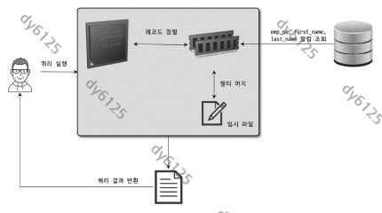
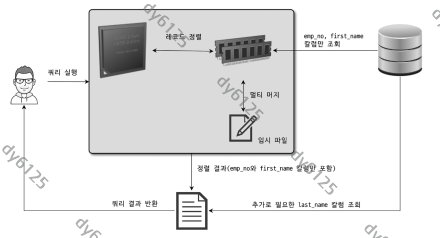
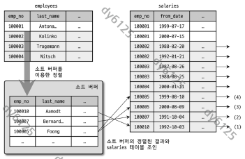
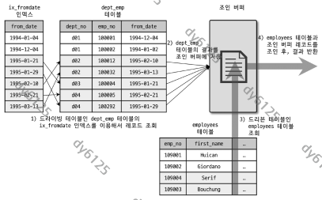
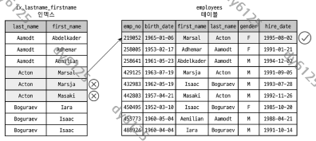
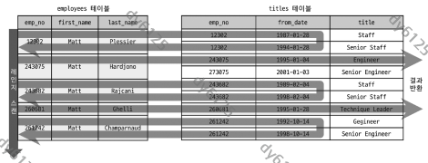
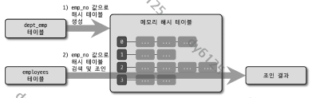
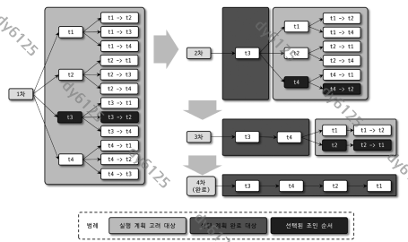

# Real MySQL 8.0 9장 옵티마이저와 힌트

## 9.1 개요

### 9.1.1 쿼리 실행 절차

- 쿼리는 세 단계를 거침
  1. SQL 파서가 문장을 쪼개 파스 트리를 생성. 문법 오류는 여기서 걸러짐
  2. 옵티마이저가 파스 트리를 보고 불필요한 조건을 지우고, 조인 순서와 사용할 인덱스를 정하고, 임시 테이블이 필요한지 판단. 이 단계의 산출물이 실행 계획
  3. 실행 계획대로 스토리지 엔진에서 레코드를 읽어 오고, MySQL 엔진이 조인과 정렬을 수행
- 앞의 두 단계는 MySQL 엔진이 혼자 처리하고, 세 번째 단계만 MySQL 엔진과 스토리지 엔진이 나눠 맡음

### 9.1.2 옵티마이저의 종류

| 종류 | 방식 | 비고 |
| --- | --- | --- |
| 규칙 기반 최적화(RBO) | 통계를 보지 않고 내장된 우선순위 규칙으로 계획을 세움 | 같은 쿼리면 거의 같은 계획. 초기 오라클이 사용 |
| 비용 기반 최적화(CBO) | 가능한 계획을 여러 개 만들어 단위 작업 비용과 통계 정보로 비용을 비교 | MySQL을 포함한 대부분의 RDBMS |

- RBO는 통계가 부족하고 CPU가 느려 비용 계산 자체가 부담이던 시절의 산물. 데이터 분포가 제각각인 현실에서는 CBO가 맞음

## 9.2 기본 데이터 처리

### 9.2.1 풀 테이블 스캔과 풀 인덱스 스캔

- 옵티마이저가 풀 테이블 스캔을 고르는 경우 셋
  - 테이블이 페이지 하나 정도로 작을 때
  - WHERE나 ON 절에 인덱스를 탈 조건이 없을 때
  - 레인지 스캔은 되지만 일치 건수가 너무 많다고 판단할 때
- InnoDB는 풀 스캔 때 페이지를 하나씩 읽지 않음. 포그라운드 스레드가 연속된 페이지를 `innodb_read_ahead_threshold`만큼 읽으면 백그라운드 스레드가 리드 어헤드를 시작해 최대 64개 페이지까지 미리 버퍼 풀에 올림. 풀 인덱스 스캔에도 적용
- `SELECT COUNT(*) FROM employees`는 풀 테이블 스캔처럼 보이지만 실제로는 풀 인덱스 스캔이 될 때가 많음. 건수만 필요하면 테이블보다 작은 인덱스를 읽는 쪽이 디스크 읽기가 적음. `SELECT *`처럼 레코드에만 있는 컬럼이 필요하면 풀 테이블 스캔

### 9.2.2 병렬 처리

- 8.0부터 쿼리 하나를 여러 스레드가 나눠 처리하는 병렬 처리가 생김. 스레드 수는 `innodb_parallel_read_threads`
- WHERE 없이 전체 건수를 세는 쿼리에만 적용. salaries 전체 건수 세기가 스레드 1개에서 0.32초, 8개에서 0.13초
- CPU 코어 수를 넘기면 오히려 느려짐

### 9.2.3 ORDER BY 처리(Using filesort)

- 정렬은 인덱스를 이용하거나 실행 시점에 파일소트를 거침. 인덱스 정렬은 읽기만 하면 되지만 쓰기마다 인덱스 유지 비용이 듦
- 정렬 기준이 너무 많거나 GROUP BY·DISTINCT 결과를 다시 정렬해야 하면 인덱스로 처리 불가
- 별도 정렬이 있었는지는 Extra의 Using filesort로 확인

#### 9.2.3.1 소트 버퍼

- 정렬을 위해 세션이 따로 할당받는 메모리. `sort_buffer_size`가 상한
- 정렬 대상이 버퍼보다 크면 버퍼 단위로 정렬한 조각을 디스크에 기록하고 마지막에 병합. 이 횟수가 `Sort_merge_passes`
- 버퍼를 키우면 빨라질 것 같지만 salaries 284만 건 정렬 벤치마크에서는 256KB에서 8MB 사이가 최적이었고 그 밖의 구간은 차이 없음
- 세션 메모리라서 커넥션 수에 비례해 소비. 10MB 이상으로 잡으면 대량 정렬이 여러 커넥션에서 동시에 돌 때 OOM-Killer가 MySQL을 죽임
- 트랜잭션 처리용 서버라면 56KB에서 1MB 미만이 적절. 대량 정렬은 그 세션에서만 잠시 키움

#### 9.2.3.2 정렬 알고리즘

- 소트 버퍼에 무엇을 담느냐로 구분
  - 싱글 패스: 레코드 전체
  - 투 패스: 정렬 키와 PK만
- 어느 쪽인지는 `SET OPTIMIZER_TRACE="enabled=on"` 뒤 INFORMATION_SCHEMA.OPTIMIZER_TRACE의 sort_mode로 확인

| sort_mode | 소트 버퍼에 담는 것 | 책의 분류 |
| --- | --- | --- |
| `<sort_key, rowid>` | 정렬 키와 로우 아이디 | 투 패스 |
| `<sort_key, additional_fields>` | 정렬 키와 레코드 전체(고정 길이) | 싱글 패스 |
| `<sort_key, packed_additional_fields>` | 정렬 키와 레코드 전체(가변 길이, 5.7 도입) | 싱글 패스 |

- 싱글 패스: `SELECT emp_no, first_name, last_name ... ORDER BY first_name`에서 정렬에 필요 없는 last_name까지 처음부터 소트 버퍼에 담아 정렬한 뒤 버퍼 내용을 그대로 반환



- 투 패스: first_name과 PK인 emp_no만 담아 정렬한 다음, 정렬된 순서대로 테이블을 한 번 더 읽어 last_name을 채움



- 투 패스는 테이블을 두 번 읽지만 소트 버퍼 사용량이 훨씬 적음. 128KB 버퍼에서 투 패스는 약 7,000건, 싱글 패스는 그 절반을 정렬
- 최신 버전은 보통 싱글 패스를 쓰되 레코드가 크거나 BLOB·TEXT 컬럼이 있으면 투 패스로 내려감. `SELECT *` 습관이 소트 버퍼를 몇 배씩 낭비하는 이유

#### 9.2.3.3 정렬 처리 방법

- ORDER BY가 있는 쿼리는 셋 중 하나로 처리되며 아래로 갈수록 느림

| 정렬 처리 방법 | 적용 조건 | Extra 표시 | 정렬 대상 | 처리 형태 |
| --- | --- | --- | --- | --- |
| 인덱스를 사용한 정렬 | ORDER BY 컬럼이 드라이빙 테이블에 있고 그 순서의 인덱스가 있음. WHERE 조건과 같은 인덱스를 써야 하고 네스티드 루프 조인일 때만 | 없음 | 없음. 인덱스 순서대로 읽기만 함 | 스트리밍 |
| 조인에서 드라이빙 테이블만 정렬 | ORDER BY 컬럼이 드라이빙 테이블에 있지만 인덱스와 무관 | Using filesort | 드라이빙 테이블의 일치 레코드 | 버퍼링 |
| 조인 결과를 임시 테이블에 저장 후 정렬 | ORDER BY 컬럼이 드리븐 테이블에 있음. 조인을 끝내야 정렬 가능 | Using temporary; Using filesort | 조인 결과 전체 | 버퍼링 |

- `WHERE e.emp_no BETWEEN 100002 AND 100020 ORDER BY e.emp_no`는 PK 순서대로 읽으므로 ORDER BY가 없어도 같은 순서. 그래도 ORDER BY를 빼면 안 됨. 실행 계획이 조금만 바뀌면 순서가 깨져 애플리케이션 버그가 됨



- 조인하면 건수와 레코드 크기가 배수로 불어나므로 드라이빙 테이블만 정렬하는 쪽이 임시 테이블 방식보다 훨씬 유리
- 세 방법의 성능 차이는 스트리밍과 버퍼링의 차이

| 구분 | 동작 | 첫 레코드 응답 | LIMIT의 효과 | 해당 정렬 방법 |
| --- | --- | --- | --- | --- |
| 스트리밍 | 조건에 맞는 레코드를 찾는 즉시 클라이언트로 보냄 | 빠름 | 서버 작업량과 전체 시간이 함께 줄어듦 | 인덱스를 사용한 정렬 |
| 버퍼링 | WHERE에 맞는 레코드를 모두 모아 정렬·그루핑을 끝낸 뒤에야 보내기 시작 | 느림 | 네트워크 전송량만 줄고 서버 작업량은 거의 그대로 | 드라이빙 테이블만 정렬, 임시 테이블 정렬 |

- JDBC는 서버가 스트리밍해도 라이브러리가 마지막 레코드까지 버퍼링한 뒤 애플리케이션에 돌려줌. 서버 쪽 스트리밍과 클라이언트 쪽 동작은 별개
- 성능 비교: tb_test1 100건, tb_test2 1,000건(tb_test1 1건당 10건)을 조인해 `ORDER BY t1.col2 LIMIT 10`을 처리하는 경우. tb_test1이 드라이빙

| 정렬 처리 방법 | tb_test1 읽기 | 정렬 | 조인 | tb_test2 읽기 | 임시 테이블 |
| --- | --- | --- | --- | --- | --- |
| 인덱스를 사용한 정렬 | 1건 | 없음 | 1번 | 10건 | 없음 |
| 조인에서 드라이빙 테이블만 정렬 | 100건 | 100건 | 1번 | 10건 | 없음 |
| 조인 결과를 임시 테이블에 저장 후 정렬 | 100건 | 1,000건 | 100번 | 1,000건 | 1,000건 저장 |

- 어느 테이블이 드라이빙되는지보다 어떤 정렬 방식이 쓰이는지가 성능을 더 크게 가름
- 파일소트에서도 LIMIT 10이 있으면 상위 10건이 채워지는 순간 정렬을 멈추긴 하지만, 퀵 소트와 힙 소트 특성상 기대만큼 빨라지지는 않음

#### 9.2.3.4 정렬 관련 상태 변수

- `FLUSH STATUS` 뒤 `SHOW STATUS LIKE 'Sort%'`로 확인
- Sort_merge_passes는 병합 횟수, Sort_range와 Sort_scan은 레인지 스캔·풀 스캔 결과를 정렬한 횟수, Sort_rows는 정렬한 건수

### 9.2.4 GROUP BY 처리

- GROUP BY도 스트리밍을 막음. HAVING은 그루핑 결과를 필터링하므로 인덱스로 처리 불가
- 처리 방식 셋
  - 타이트 인덱스 스캔: 인덱스를 차례로 읽음
  - 루스 인덱스 스캔: 인덱스를 건너뛰며 읽음
  - 임시 테이블: 인덱스를 못 쓸 때

#### 9.2.4.1 인덱스 스캔을 이용하는 GROUP BY(타이트 인덱스 스캔)

- 드라이빙 테이블의 컬럼만으로 그루핑하고 그 컬럼에 인덱스가 있으면 인덱스를 차례로 읽으며 그루핑
- 집계 함수 계산에 임시 테이블이 필요할 수는 있지만 추가 정렬은 없고 Extra에도 별도 코멘트 없음

#### 9.2.4.2 루스 인덱스 스캔을 이용하는 GROUP BY

- 적용되면 Extra에 Using index for group-by
- `SELECT emp_no FROM salaries WHERE from_date='1985-03-01' GROUP BY emp_no`에서 인덱스는 (emp_no, from_date)라 from_date만으로는 레인지 스캔 불가. 서버는 emp_no의 첫 유니크 값을 찾아 `emp_no=10001 AND from_date='1985-03-01'`로 검색하고, 다음 유니크 emp_no로 건너뛰어 반복
- 레인지 스캔과 반대로 유니크 값이 적을수록 빨라짐
- 단일 테이블 GROUP BY에만 적용. MIN·MAX 외의 집계 함수가 있거나 GROUP BY 컬럼이 인덱스 왼쪽부터 일치하지 않으면 불가

#### 9.2.4.3 임시 테이블을 사용하는 GROUP BY

- 그루핑 컬럼이 인덱스를 전혀 쓰지 못하면 임시 테이블로 처리

```sql
mysql> EXPLAIN SELECT e.last_name, AVG(s.salary)
       FROM employees e, salaries s
       WHERE s.emp_no=e.emp_no GROUP BY e.last_name;
```

```text
+----+-------+------+---------+--------+-----------------+
| id | table | type | key     | rows   | Extra           |
+----+-------+------+---------+--------+-----------------+
|  1 | e     | ALL  | NULL    | 300584 | Using temporary |
|  1 | s     | ref  | PRIMARY |     10 | NULL            |
+----+-------+------+---------+--------+-----------------+
```

- Using filesort가 없음. 8.0 이전에는 GROUP BY에 묵시적 정렬이 따라왔지만 8.0에서 사라짐
- 서버는 GROUP BY 컬럼으로 유니크 인덱스를 가진 임시 테이블을 만들고 조인 결과를 한 건씩 INSERT 또는 UPDATE하며 중복 제거와 집계를 함께 수행
- 5.7까지 권장되던 `ORDER BY NULL`은 이제 불필요

### 9.2.5 DISTINCT 처리

- 집계 함수 없는 SELECT DISTINCT는 GROUP BY와 같은 방식으로 처리
- `SELECT DISTINCT(first_name), last_name`의 괄호는 의미 없는 괄호로 지워지고 결과는 (first_name, last_name) 조합이 유니크한 레코드. DISTINCT는 함수가 아님
- 집계 함수 안의 DISTINCT는 그 인자에만 적용. `COUNT(DISTINCT s.salary)`는 salary 값만 담는 임시 테이블을 만들지만 실행 계획에는 Using temporary가 표시되지 않음

### 9.2.6 내부 임시 테이블 활용

- MySQL 엔진이 정렬·그루핑 중간 결과를 담기 위해 만드는 테이블. 다른 세션에서 볼 수 없고 쿼리가 끝나면 삭제
- 8.0 이전에는 메모리 임시 테이블에 MEMORY, 디스크 임시 테이블에 MyISAM 엔진. 8.0부터는 가변 길이를 지원하는 TempTable 엔진과 InnoDB
- TempTable이 쓸 수 있는 메모리는 `temptable_max_ram`(기본 1GB). 넘으면 MMAP 파일로 내려감
- 디스크 임시 테이블 파일은 열자마자 삭제되고 열린 핸들로만 쓰이므로 ls로 보이지 않음. lsof의 deleted는 사용 중이라는 뜻

- 임시 테이블을 쓰는 대표 패턴 다섯
  - ORDER BY와 GROUP BY 컬럼이 다른 쿼리
  - 두 절의 컬럼이 조인 순서상 첫 테이블이 아닌 쿼리
  - DISTINCT와 ORDER BY가 함께 있거나 DISTINCT가 인덱스로 처리되지 않는 쿼리
  - UNION 또는 UNION DISTINCT(8.0부터 UNION ALL은 쓰지 않음)
  - select_type이 DERIVED인 쿼리
- 뒤의 세 패턴은 Using temporary가 표시되지 않아도 임시 테이블 사용
- UNION이나 GROUP BY·DISTINCT 컬럼에 512바이트 이상인 컬럼이 있으면 처음부터 디스크에 생성
- 메모리였는지 디스크였는지는 `SHOW SESSION STATUS LIKE 'Created_tmp%'`의 Created_tmp_tables와 Created_tmp_disk_tables로 확인

## 9.3 고급 최적화

### 9.3.1 옵티마이저 스위치 옵션

- `optimizer_switch` 변수 하나에 여러 옵션을 세트로 담음. `SET GLOBAL optimizer_switch='index_merge=on,...'`처럼 서버나 세션에 설정하고, `SET_VAR` 힌트로 쿼리 하나에만 적용 가능
- 테스트 때 바꿨다면 `SET optimizer_switch='default'`로 꼭 되돌림. 바꾼 사실을 잊고 다른 쿼리의 느린 계획을 엉뚱한 곳에서 찾는 일이 많음

#### 9.3.1.1 MRR과 배치 키 액세스(mrr & batched_key_access)

- 네스티드 루프 조인은 드라이빙 레코드 한 건마다 스토리지 엔진에 읽기를 요청하므로 엔진이 최적화할 여지가 없음
- MRR은 드라이빙 레코드를 조인 버퍼에 모아 두다가 한 번에 넘기고, 스토리지 엔진은 키를 페이지 순서로 정렬해 접근. 이를 조인에 응용한 것이 BKA 조인
- 부가 정렬 때문에 느려지는 경우가 있어 기본값 off

#### 9.3.1.2 블록 네스티드 루프 조인(block_nested_loop)

- 드리븐 테이블의 조인 조건에 인덱스가 없으면 드라이빙 1,000건에 풀 스캔 1,000번. 이때 드라이빙 결과를 조인 버퍼(join_buffer_size)에 캐시하고 드리븐을 한 번 읽으며 버퍼와 맞춤
- Extra에 Using join buffer



- 실제 결합은 드리븐 테이블을 기준으로 버퍼를 뒤지므로 결과 순서가 드라이빙 순서를 따르지 않음
- 8.0.20부터 BNL은 해시 조인으로 대체

#### 9.3.1.3 인덱스 컨디션 푸시다운(index_condition_pushdown)

- (last_name, first_name) 인덱스에서 `WHERE last_name='Acton' AND first_name LIKE '%sal'`의 first_name 조건은 범위를 좁히지 못하는 필터 조건
- 5.5까지는 이런 조건을 스토리지 엔진에 넘기지 않아 Acton 10만 건을 모두 테이블에서 읽어 올린 뒤 MySQL 엔진이 거름
- 5.6부터 인덱스에 있는 컬럼의 조건을 스토리지 엔진에 내려보내 인덱스 단계에서 걸러내고 남은 건만 테이블을 읽음. Extra가 Using where에서 Using index condition으로 바뀜



#### 9.3.1.4 인덱스 확장(use_index_extensions)

- InnoDB 보조 인덱스 리프에는 PK가 붙어 있으므로 PK가 (dept_no, emp_no)인 테이블의 ix_fromdate(from_date)는 (from_date, dept_no, emp_no)처럼 동작
- `WHERE from_date='1987-07-25' AND dept_no='d001'`의 key_len이 3이 아니라 19로 나오는 것이 증거

#### 9.3.1.5 인덱스 머지(index_merge)

- 옵티마이저는 보통 테이블당 인덱스 하나만 사용. 각 조건이 다른 인덱스를 쓸 수 있고 어느 조건도 혼자서는 범위를 충분히 줄이지 못하면 둘 이상을 써서 병합

| 방식 | 스위치 | 쓰이는 조건 | Extra |
| --- | --- | --- | --- |
| 교집합 | index_merge_intersection | AND. `first_name='Georgi' AND emp_no BETWEEN 10000 AND 20000`(253건 ∩ 10,000건 = 14건) | Using intersect(ix_firstname,PRIMARY) |
| 합집합 | index_merge_union | OR, 각 결과가 PK 순으로 정렬된 동등 비교. 우선순위 큐로 정렬 없이 중복 제거 | Using union(ix_firstname,ix_hiredate) |
| 정렬 후 합집합 | index_merge_sort_union | OR, 한쪽이 범위 조건이라 PK 순이 아님. 정렬 뒤 중복 제거 | Using sort_union(...) |

- ix_firstname에 PK가 포함돼 있으니 그 인덱스 하나가 낫다고 판단하면 교집합 스위치를 끔
- AND 조건은 하나만 인덱스를 써도 되지만, OR 조건은 하나라도 인덱스를 못 쓰면 풀 테이블 스캔밖에 없음

#### 9.3.1.9 세미 조인(semijoin)

- 다른 테이블과 실제로 조인하지 않고 일치 레코드가 있는지만 확인하는 쿼리
- 5.7까지는 `WHERE e.emp_no IN (SELECT de.emp_no FROM dept_emp de WHERE ...)`을 처리할 때 서브쿼리 57건을 얻고도 employees 30만 건을 풀 스캔하며 한 건씩 비교
- 8.0의 전략 다섯

| 전략 | 동작 | 스위치 | 상관 서브쿼리 | GROUP BY·집계 |
| --- | --- | --- | --- | --- |
| 테이블 풀아웃 | 서브쿼리 테이블을 아우터로 끌어내 조인으로 재작성 | 없음(항상 적용) | - | - |
| 퍼스트 매치 | 조인으로 처리하되 첫 일치 레코드만 찾고 중단 | firstmatch | 가능 | 불가 |
| 루스 스캔 | 서브쿼리 테이블을 루스 인덱스 스캔으로 유니크하게 읽어 드라이빙 | loosescan | - | - |
| 구체화 | 서브쿼리를 임시 테이블로 만든 뒤 조인 | materialization | 불가 | 가능 |
| 중복 제거 | INNER JOIN 후 임시 테이블로 중복 제거 | duplicateweedout | 가능 | 불가 |

- 테이블 풀아웃
  - 서브쿼리가 UNIQUE 인덱스나 PK 룩업으로 1건을 돌려줄 때만 적용
  - Extra에 표시가 없어 SHOW WARNINGS로 재작성된 쿼리를 확인. IN(subquery)가 JOIN으로 바뀌어 있음
- 퍼스트 매치
  - IN을 EXISTS로 튜닝한 것과 비슷하게 동작
  - 아우터 테이블을 읽고 서브쿼리 테이블과 조인하다가 첫 일치 레코드를 찾으면 그 레코드는 즉시 결과로 보내고 더 뒤지지 않음
  - 5.5의 IN-to-EXISTS보다 나은 점: 동등 조건 전파가 아우터 테이블까지 퍼지고, 옵티마이저가 일부 테이블에만 적용할지 선택 가능

```sql
mysql> EXPLAIN SELECT * FROM employees e
       WHERE e.first_name='Matt'
         AND e.emp_no IN (SELECT t.emp_no FROM titles t
                          WHERE t.from_date BETWEEN '1995-01-01' AND '1995-01-30');
```



- 위 예제는 titles 행의 Extra에 FirstMatch(e). Matt인 사원을 읽고 titles에서 from_date 조건에 맞는 첫 레코드를 찾는 즉시 다음 사원으로 넘어감
- 루스 스캔
  - 서브쿼리가 `SELECT keypart1 FROM tab` 또는 `SELECT keypart2 FROM tab WHERE keypart1=상수` 형태일 때 적용
  - 서브쿼리 테이블을 드라이빙으로 잡고 인덱스를 건너뛰며 유니크 값만 읽음. dept_emp 33만 건이 dept_no 유니크 값 9건으로 줄어듦
  - Extra에 LooseScan
- 구체화
  - 서브쿼리를 통째로 내부 임시 테이블로 만든 뒤 아우터 테이블과 조인
  - 아우터 테이블에 다른 조건이 없어 퍼스트 매치로는 풀 스캔이 되는 경우에 유리
  - 실행 계획에 테이블 수보다 행이 하나 많고 select_type에 MATERIALIZED

```text
+----+--------------+-------------+--------+-------------+--------------------+
| id | select_type  | table       | type   | key         | ref                |
+----+--------------+-------------+--------+-------------+--------------------+
|  1 | SIMPLE       | <subquery2> | ALL    | NULL        | NULL               |
|  1 | SIMPLE       | e           | eq_ref | PRIMARY     | <subquery2>.emp_no |
|  2 | MATERIALIZED | de          | ref    | ix_fromdate | const              |
+----+--------------+-------------+--------+-------------+--------------------+
```

- 중복 제거
  - 세미 조인을 INNER JOIN으로 실행하고 마지막에 임시 테이블로 중복을 지움
  - `WHERE e.emp_no IN (SELECT s.emp_no FROM salaries s WHERE s.salary>150000)`처럼 서브쿼리에서 한 사원이 여러 번 나올 때. 서버는 `employees JOIN salaries ... GROUP BY e.emp_no`와 같은 일을 함
  - Extra에 Duplicate Weedout 문구는 없고, 반복 구간의 시작 테이블에 Start temporary, 끝 테이블에 End temporary

#### 9.3.1.15 컨디션 팬아웃(condition_fanout_filter)

- 조인 순서는 일치 레코드가 적은 테이블부터 잡으므로 각 테이블의 조건 만족 건수를 정확히 예측해야 함
- `WHERE first_name='Matt' AND hire_date BETWEEN ...`에서 실제 쿼리는 ix_firstname만 사용. 스위치가 off면 Matt 233건이 모두 hire_date 조건도 만족한다고 보고 filtered를 100으로, on이면 히스토그램이나 인덱스 통계로 23.2로 낮춤
- 계산이 정밀해지는 대신 실행 계획 수립 비용 증가

#### 9.3.1.16 파생 테이블 머지(derived_merge)

- FROM 절 서브쿼리를 임시 테이블로 만들지 않고 외부 쿼리에 병합
- 집계 함수·DISTINCT·GROUP BY·LIMIT·UNION이 있는 서브쿼리는 병합되지 않으므로 가능하면 손으로 외부 쿼리에 합침

#### 9.3.1.17 인비저블 인덱스(use_invisible_indexes)

- `ALTER TABLE employees ALTER INDEX ix_hiredate INVISIBLE`로 인덱스를 지우지 않고 옵티마이저에게만 숨김. 인덱스를 지우기 전에 성능 영향을 지켜보는 용도
- 숨긴 인덱스도 DML마다 갱신되므로 쓰기 비용은 그대로

#### 9.3.1.18 스킵 스캔(skip_scan)

- 8장의 인덱스 스킵 스캔을 제어. `SKIP_SCAN(employees ix_gender_birthdate)`, `NO_SKIP_SCAN(employees)` 힌트로도 제어

#### 9.3.1.19 해시 조인(hash_join)

- 8.0.18부터 도입. 해시 조인은 첫 레코드를 내기까지 오래 걸리고 마지막 레코드는 빨리 끝냄. 네스티드 루프는 반대
- 즉 해시 조인은 스루풋에, 네스티드 루프는 응답 속도에 맞는 전략. OLTP용 MySQL은 조인 컬럼에 인덱스가 없거나 한쪽이 아주 작을 때의 차선책으로만 쓰므로 빠르다는 이유만으로 힌트로 강제하지 않음
- 8.0.20부터 BNL이 사라져 네스티드 루프를 못 쓰면 항상 해시 조인. block_nested_loop 스위치와 BNL·NO_BNL 힌트가 해시 조인을 제어

```sql
mysql> EXPLAIN FORMAT=TREE
       SELECT * FROM employees e IGNORE INDEX(PRIMARY, ix_hiredate)
         INNER JOIN dept_emp de IGNORE INDEX(ix_empno_fromdate, ix_fromdate)
           ON de.emp_no=e.emp_no AND de.from_date=e.hire_date \G
-> Inner hash join (e.hire_date = de.from_date), (e.emp_no = de.emp_no)
    -> Table scan on e
    -> Hash
        -> Table scan on de
```



- 건수가 적은 테이블로 조인 버퍼에 해시 테이블을 만드는 빌드 단계와, 나머지 테이블을 읽으며 짝을 찾는 프로브 단계. TREE 포맷에서 가장 안쪽 dept_emp가 빌드 테이블
- 버퍼가 넘치면 양쪽을 청크로 나눠 디스크에 저장하고 청크 쌍마다 다시 조인

#### 9.3.1.20 인덱스 정렬 선호(prefer_ordering_index)

- 옵티마이저는 ORDER BY를 인덱스로 처리할 수 있으면 그 인덱스에 가중치를 높게 둠. 그래서 `WHERE hire_date BETWEEN ... ORDER BY emp_no`에서 ix_hiredate 대신 PK를 풀 스캔하는 실수를 가끔 함
- 8.0.21부터 이 스위치를 off로 하면 그 가중치가 사라짐

### 9.3.2 조인 최적화 알고리즘

- 조인 테이블이 많아지면 최적 계획을 찾는 시간이 급증
- 알고리즘 둘
  - Exhaustive 검색: 5.0 이전 방식. 모든 조합의 비용을 계산. 테이블 20개면 20!개 조합
  - Greedy 검색: 5.0부터. `optimizer_search_depth`개로 조합을 만들어 가장 싼 계획의 첫 테이블을 확정하고, 남은 테이블로 반복해 순서를 하나씩 채움



| 변수 | 의미 | 권장 |
| --- | --- | --- |
| optimizer_search_depth | 0~62. 조인 테이블 수가 이 값보다 크면 그만큼은 Exhaustive, 나머지는 Greedy | 기본 62 |
| optimizer_prune_level | 1이면 이미 찾은 계획보다 비용이 커지는 순서를 즉시 포기 | 기본 1. 0으로 두지 않는다 |

- 30개 테이블 조인에서 prune_level=1이면 search_depth를 어떻게 바꿔도 0.01초 안에 끝났고, 0이면 search_depth 10에서 4.6초, 15부터는 측정 불가
- 8.0에서는 두 변수를 조정할 일이 거의 없음

## 9.4 쿼리 힌트

- 개발자가 아는 사실을 옵티마이저에 알려 주는 수단
- 힌트의 두 종류
  - 인덱스 힌트: 예전부터 있던 방식. SQL 문법의 일부라 ANSI 표준을 깨뜨림
  - 옵티마이저 힌트: 5.6부터. 주석이라 다른 RDBMS에서도 무해
- 가능하면 옵티마이저 힌트 사용

### 9.4.1 인덱스 힌트

#### 9.4.1.1 STRAIGHT_JOIN

- FROM 절 순서대로 조인하도록 고정. 힌트가 없으면 옵티마이저는 레코드가 9건인 departments를 드라이빙으로 잡고, 힌트를 주면 employees 30만 건을 풀 스캔
- 조인 순서는 보통 인덱스를 탈 수 있는 조건까지 적용한 레코드 수가 적은 테이블이 드라이빙
- 힌트를 쓸 만한 경우는 옵티마이저가 다음을 어겼을 때
  - 임시 테이블과 일반 테이블의 조인은 임시 테이블을 드라이빙으로
  - 임시 테이블끼리는 크기가 작은 쪽을 드라이빙으로
  - 일반 테이블끼리는 양쪽 다 인덱스가 있거나 없으면 레코드가 적은 쪽, 그 외에는 조인 컬럼에 인덱스가 없는 쪽을 드라이빙으로

#### 9.4.1.2 USE INDEX / FORCE INDEX / IGNORE INDEX

- 테이블 이름 바로 뒤에 쓰고 PK는 PRIMARY로 표기

| 힌트 | 효과 |
| --- | --- |
| USE INDEX | 특정 인덱스 사용을 권장. 대부분 따르지만 항상은 아니다 |
| FORCE INDEX | USE INDEX보다 강하다. 책 저자 경험상 USE INDEX로 안 되면 FORCE INDEX로도 안 됐다 |
| IGNORE INDEX | 특정 인덱스를 쓰지 못하게 한다. 풀 테이블 스캔을 유도할 때도 쓴다 |

- FOR JOIN, FOR ORDER BY, FOR GROUP BY로 용도 한정 가능
- 최적 계획은 데이터 분포에 따라 달라지므로 판단이 어렵다면 힌트로 개입하지 않는 편이 나음. 가장 좋은 최적화는 그 쿼리를 없애거나 데이터를 줄이는 일, 그다음은 모델을 단순화해 힌트가 필요 없게 만드는 일

#### 9.4.1.3 SQL_CALC_FOUND_ROWS

- LIMIT이 있어도 끝까지 읽고 FOUND_ROWS()로 전체 건수를 돌려줌. 페이징에 편리해 보이지만 쓰지 않음
- `first_name='Georgi' LIMIT 0, 20`에서 이 힌트는 일치 253건을 모두 테이블에서 읽어 랜덤 I/O 253번. COUNT(*)와 LIMIT 쿼리로 나누면 COUNT(*)는 커버링 인덱스라 데이터 조회는 20번만
- 성능이 아니라 개발 편의를 위한 기능

### 9.4.2 옵티마이저 힌트

#### 9.4.2.1 옵티마이저 힌트 종류

| 범위 | 힌트 |
| --- | --- |
| 글로벌 | MAX_EXECUTION_TIME, RESOURCE_GROUP, SET_VAR |
| 쿼리 블록 | SUBQUERY, SEMIJOIN·NO_SEMIJOIN, JOIN_FIXED_ORDER, JOIN_ORDER, JOIN_PREFIX, JOIN_SUFFIX, QB_NAME |
| 쿼리 블록·테이블 | BKA·NO_BKA, BNL·NO_BNL, HASH_JOIN·NO_HASH_JOIN(8.0.18만) |
| 테이블 | MERGE·NO_MERGE |
| 테이블·인덱스 | INDEX_MERGE·NO_INDEX_MERGE, MRR·NO_MRR, NO_ICP, NO_RANGE_OPTIMIZATION, SKIP_SCAN·NO_SKIP_SCAN |
| 인덱스 | INDEX·NO_INDEX, GROUP_INDEX·NO_GROUP_INDEX, JOIN_INDEX·NO_JOIN_INDEX, ORDER_INDEX·NO_ORDER_INDEX |

- 인덱스 수준 힌트에는 반드시 테이블명을 먼저 표기. `NO_INDEX(ix_firstname)`처럼 인덱스명만 적으면 SHOW WARNINGS에 "Unresolved name"
- 익숙하지 않은 힌트는 EXPLAIN의 경고 수를 먼저 확인
- 서브쿼리를 가리키려면 QB_NAME으로 이름을 붙임

```sql
mysql> EXPLAIN
       SELECT /*+ JOIN_ORDER(e, s@subq1) */ COUNT(*)
       FROM employees e
       WHERE e.first_name='Matt'
         AND e.emp_no IN (SELECT /*+ QB_NAME(subq1) */ s.emp_no
                          FROM salaries s WHERE s.salary BETWEEN 50000 AND 50500);
```

| 힌트 | 하는 일 | 메모 |
| --- | --- | --- |
| MAX_EXECUTION_TIME | 밀리초 단위 최대 실행 시간. 넘기면 ERROR 3024 | 실행 계획에 영향을 주지 않는 유일한 힌트 |
| SET_VAR | 쿼리 하나에만 시스템 변수를 바꿈 | `SET_VAR(optimizer_switch='index_merge_intersection=off')`. 대용량 쿼리의 조인·소트 버퍼 조정에도 쓴다 |
| SEMIJOIN / NO_SEMIJOIN | 세미 조인 전략을 DUPSWEEDOUT, FIRSTMATCH, LOOSESCAN, MATERIALIZATION 중에서 고름 | 서브쿼리 안에 적거나 QB_NAME으로 가리킨다. 테이블 풀아웃은 힌트가 없다 |
| SUBQUERY | 세미 조인이 안 되는 서브쿼리(주로 안티 세미 조인)에 INTOEXISTS 또는 MATERIALIZATION | 쓸 기회가 적다 |
| BNL / NO_BNL | 8.0.20부터 해시 조인을 유도하거나 막음 | HASHJOIN·NO_HASHJOIN은 8.0.18에서만 유효. 조인 컬럼에 인덱스가 있으면 힌트를 줘도 네스티드 루프 |
| MERGE / NO_MERGE | FROM 절 서브쿼리를 병합할지 임시 테이블로 만들지 | NO_MERGE면 실행 계획에 `<derived2>` 행이 생긴다 |
| INDEX_MERGE / NO_INDEX_MERGE | 인덱스 머지에 쓸 인덱스를 지정하거나 제외 | `NO_INDEX_MERGE(employees PRIMARY)` |
| NO_ICP | ICP를 끈다. 켜는 힌트는 없다 | ICP 가능한 인덱스의 비용이 낮게 예측돼 더 나은 인덱스가 밀릴 때, 인덱스를 강제하는 대신 ICP만 끈다 |
| SKIP_SCAN / NO_SKIP_SCAN | 스킵 스캔 강제·금지 | NO_SKIP_SCAN을 주면 type이 range에서 index로 바뀐다 |

#### 9.4.2.7 JOIN_FIXED_ORDER / JOIN_ORDER / JOIN_PREFIX / JOIN_SUFFIX

- STRAIGHT_JOIN은 FROM 절 순서를 다시 배치해야 하고 모든 테이블의 순서가 고정됨. 네 힌트가 이를 보완

| 힌트 | 고정하는 범위 | 예 |
| --- | --- | --- |
| JOIN_FIXED_ORDER | 모든 테이블을 FROM 절 순서로. STRAIGHT_JOIN과 같다 | `/*+ JOIN_FIXED_ORDER() */` |
| JOIN_ORDER | 나열한 테이블의 상대 순서만 | `/*+ JOIN_ORDER(d, de) */` |
| JOIN_PREFIX | 드라이빙 테이블만 | `/*+ JOIN_PREFIX(e, de) */` |
| JOIN_SUFFIX | 마지막에 조인될 테이블만 | `/*+ JOIN_SUFFIX(de, e) */` |

#### 9.4.2.12 INDEX / NO_INDEX

- 인덱스 힌트를 대체. 테이블명과 인덱스명을 함께 표기
- `FROM employees USE INDEX(ix_firstname)`은 `SELECT /*+ INDEX(employees ix_firstname) */ * FROM employees`로 변경

| 인덱스 힌트 | 옵티마이저 힌트 |
| --- | --- |
| USE INDEX / IGNORE INDEX | INDEX / NO_INDEX |
| USE INDEX FOR GROUP BY / IGNORE | GROUP_INDEX / NO_GROUP_INDEX |
| USE INDEX FOR ORDER BY / IGNORE | ORDER_INDEX / NO_ORDER_INDEX |

## 다시 확인할 질문

- 투 패스 정렬이 테이블을 두 번 읽는데도 대량 정렬에서 싱글 패스보다 유리한 이유는 무엇인가?
- 세 가지 정렬 처리 방법 중 LIMIT이 실제로 서버 작업량을 줄이는 것은 어느 방법이고 왜 그런가?
- 8.0에서 ORDER BY 없는 GROUP BY 쿼리에 Using filesort가 나오지 않는 이유를 임시 테이블 구조로 설명할 수 있는가?
- COUNT(DISTINCT ...)는 임시 테이블을 쓰면서도 왜 실행 계획에 Using temporary가 나오지 않는가?
- 인덱스 머지 Union은 정렬 없이 중복을 제거하는데 Sort union은 왜 정렬이 필요한가?
- 퍼스트 매치와 구체화는 각각 어떤 서브쿼리에 쓸 수 없는가?
- 8.0.20 이후 해시 조인을 유도하거나 막으려면 어떤 힌트와 스위치를 써야 하는가?
- STRAIGHT_JOIN 대신 JOIN_PREFIX를 쓰면 무엇이 달라지는가?

## 용어 정리

| 책 표기 | 흔히 쓰는 표기 | 뜻 |
| --- | --- | --- |
| 칼럼 | 컬럼 | 테이블의 열 |
| 실행 계획 | 실행 계획 | 어떤 테이블을 어떤 순서와 인덱스로 읽을지 정한 결과. EXPLAIN으로 본다 |
| 규칙 기반 최적화 / 비용 기반 최적화 | RBO / CBO | 내장 규칙으로 계획을 세우는 방식 / 통계와 비용 계산으로 가장 싼 계획을 고르는 방식 |
| Filesort | 파일소트 | 인덱스를 쓰지 못해 실행 시점에 따로 정렬하는 처리 |
| 싱글 패스 / 투 패스 | 싱글 패스 / 투 패스 | 레코드 전부를 소트 버퍼에 담는 방식 / 정렬 키와 PK만 담고 테이블을 다시 읽는 방식 |
| 드라이빙 / 드리븐 테이블 | 드라이빙 / 드리븐 | 조인에서 먼저 읽는 테이블 / 그 결과로 찾아가는 테이블 |
| 스트리밍 / 버퍼링 처리 | 스트리밍 / 버퍼링 | 찾는 즉시 보내는 처리 / 모두 모아 가공한 뒤 보내는 처리 |
| 내부 임시 테이블 | 임시 테이블(Using temporary) | 정렬·그루핑 중간 결과를 담는 MySQL 엔진의 테이블 |
| 블록 네스티드 루프 조인 | BNL | 드라이빙 결과를 조인 버퍼에 캐시해 두고 드리븐과 맞추는 조인 |
| 인덱스 컨디션 푸시다운 | ICP | 인덱스 컬럼 조건을 스토리지 엔진에 내려보내는 최적화 |
| 세미 조인 / 안티 세미 조인 | 세미 조인 / 안티 조인 | 일치 레코드가 있는지만 보는 IN(subquery) / 없는지만 보는 NOT IN(subquery) |
| 테이블 풀-아웃, 퍼스트 매치, 루스 스캔, 구체화, 중복 제거 | Table Pull-out, FirstMatch, LooseScan, Materialization, Duplicate Weedout | 세미 조인 다섯 전략. EXPLAIN에는 영어로 표시된다 |
| 해시 조인 | 해시 조인(빌드·프로브) | 작은 쪽으로 해시 테이블을 만들고 큰 쪽을 읽으며 찾는 조인 |
| 인덱스 힌트 / 옵티마이저 힌트 | 인덱스 힌트 / 옵티마이저 힌트 | SQL 문법 일부로 쓰는 USE INDEX 류 / `/*+ ... */` 주석으로 쓰는 힌트 |
